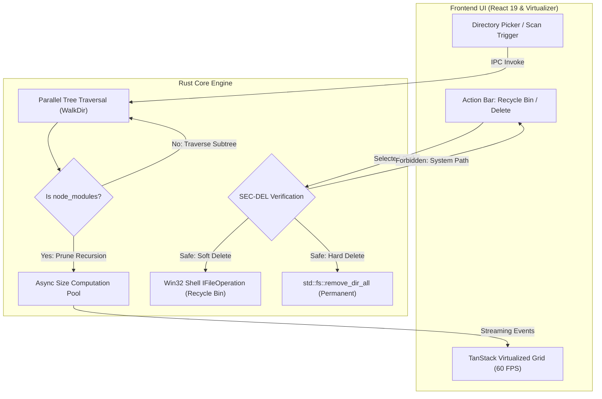

<div align="center">

# Dev Cleaner — Hızlı, Güvenli ve Çoklu Ekosistem Geliştirici Temizlik Aracı

</div>

---

<div align="center">

[](#english-version)
&nbsp;&nbsp;&nbsp;&nbsp;
[](#turkish-version)

</div>

---

<div align="center">


</div>

---

## Release status (2.2.3 — Dev Cleaner)

Dev Cleaner 2.2 is a catalog-driven, multi-ecosystem developer-artifact and
AI-agent storage reclaimer for Windows 11 x64. It ships 73 languages, a
56-rule cleanup catalog, 21 supported developer-tool caches, a built-in MCP
server, a scriptable CLI and a reversible Recycle Bin deletion path guarded by
the Rust safety layer.

Source quality gates pass: 237 frontend tests, 230 Rust library tests plus 21
integration tests, zero Clippy warnings and the full accessibility suite
(13 Playwright/axe checks). See `docs/release/TEST_MATRIX.md` for the recorded
run.

The installers attached to the tagged release are the supported downloads.
Items tracked in `docs/release/RELEASE_CHECKLIST.md` that need a human
sign-off — legal clearance, the elevated MSI run on a clean VM and design
approval — are listed there rather than hidden.

- `docs/README.md` — documentation index and reading order
- `docs/CLI.md` — terminal reference and npkill migration
- `docs/release/RELEASE_CHECKLIST.md` — gates and remaining items
- `docs/release/BUILD_PROVENANCE.md` — how a binary is tied to a commit
- `docs/security/FINAL_SECURITY_AUDIT.md` — executed evidence
- `docs/release/TEST_MATRIX.md` — test results
- `docs/MASTER_SPEC.md` — normative 2.0 specification

Dev Cleaner is free software under the MIT License. Contributions are welcome;
start with [`CONTRIBUTING.md`](CONTRIBUTING.md) and report vulnerabilities
privately as described in [`SECURITY.md`](SECURITY.md).

---

<a id="english-version"></a>

# English Version

<div align="center">
  
  <h3>Dev Cleaner — High-Performance Multi-Ecosystem Developer Artifact & AI Agent Cleaner</h3>
  <p><em>Ultra-Fast Discovery, Monorepo Hierarchy Grouping & Safe Deletion for JavaScript & TypeScript Workspaces</em></p>
  <p><strong>Developed & Published by <a href="https://vellium.dev">Vellium</a></strong></p>
</div>

<br>

## Project Overview

**Dev Cleaner** is a Windows desktop application built with **Tauri 2 (Rust)** and **React 19 (TypeScript)**. Version 2.2 discovers reproducible developer artifacts across JavaScript, Python, Rust, .NET, Java/Kotlin, Go, PHP, Dart and other ecosystems, analyses AI coding-agent storage (Codex, Claude Code, Antigravity) without reading file contents, and safely cleans selected targets. Every scan, measurement, classification and deletion runs in the Rust backend; the frontend only presents and selects backend-owned target IDs.

Traditional filesystem scanners freeze system I/O by recursing deep into nested dependency subfolders. **Dev Cleaner** solves this with an **Optimized Pruning Directory Traversal Engine**: as soon as a `node_modules` directory is discovered, deep recursive traversal is bypassed, and size calculation is offloaded to asynchronous worker pools.

With strict **Multi-Layer Safety Verification (`SEC-DEL`)**, protected system folders (like `C:\Windows`, `Program Files`, and user profile roots) cannot be selected or deleted. Dev Cleaner supports both reversible **Windows Recycle Bin** soft deletion (`IFileOperation` / `SHFileOperationW`) and lightning-fast **Permanent** deletion with interactive confirmations.

Dev Cleaner operates **100% locally** with zero telemetry, zero analytics, and zero external network dependencies.

---

## Key Features

- **One catalog, many ecosystems**: 56 evidence-backed rules cover JavaScript/TypeScript, Python, Rust, .NET, Java/Kotlin, Go, PHP, Dart, package-manager caches and AI coding-agent storage, each with a safety class and a regeneration hint.
- **Terminal-native when you want it**: `dev-cleaner scan .` prints a size-ranked table, `-i` turns it into a numbered picker, `--json` feeds CI, and `--webhook` reports to n8n/Slack/Discord. See [`docs/CLI.md`](docs/CLI.md).
- **Built-in MCP server**: coding agents can discover and preview cleanups over the Model Context Protocol, with a mandatory preview → token → execute gate.
- **Blazing-Fast Discovery Engine**: Traverses massive disk trees with millisecond response times, instantly skipping nested sub-directory recursion inside `node_modules` to find hundreds of projects without UI stutter.
- **Multi-Layer Safety Guard (`SEC-DEL`)**: Hardened path boundary checks prevent deletion of Windows system directories, user root folders, non-`node_modules` targets, or drive roots (`C:\`).
- **Monorepo & Workspace Hierarchy Detection**: Intelligently groups nested package folders under their respective monorepo root workspaces (`pnpm-workspace`, `Turbo`, `Lerna`, `Nx`, `Yarn Workspaces`, `Bun`).
- **Two-Stage Safe Deletion**:
  - **Recycle Bin (Reversible)**: Native Win32 Shell API integration (`IFileOperation`) allowing instant recovery from Windows Recycle Bin.
  - **Permanent Deletion**: Asynchronous high-throughput directory purge with double confirmation dialogs.
- **60 FPS Virtualized Grid**: TanStack Virtualizer powers buttery-smooth 60 FPS scrolling and rendering even across 10,000+ discovered project entries with zero DOM overhead.
- **Global Localization (73 Languages)**: Full native support for 73 languages with zero translation leakage via robust proxy fallbacks. RTL (Right-to-Left) dynamic mirroring for Arabic, Hebrew, Persian, and Urdu. The Windows NSIS installer speaks all 73 languages: the picker opens on every run (preselecting the remembered language) and the 21 languages NSIS does not ship are generated from English templates, including Tauri's installer messages.
- **Modern Dark-Transparent Glassmorphism UI**: Custom frameless window styling with curated dark aesthetic design tokens, smooth animations, and responsive layouts.
- **Real-Time Search & Sorting**: Filter projects by name, filesystem path, or package manager (`npm`, `pnpm`, `yarn`, `bun`), and sort by largest disk size or oldest modified date.
- **100% Offline & Private**: Zero telemetry, zero analytics, zero external network requests.

---

## Tech Stack

<div align="center">


</div>

### Backend & Core Engine (Rust)

- **Tauri 2.2**: Native Windows runtime integration, frameless window styling, and secure IPC bridge
- **WalkDir 2.5**: Optimized directory traversal with custom pruning logic
- **Trash 5.2**: Native Windows Recycle Bin COM integration
- **Tokio 1.49**: Asynchronous multi-threaded background disk scanning and task management
- **Windows API (`windows-rs` 0.58)**: Native Win32 Shell (`IFileOperation`), UI, and COM subsystem bindings
- **Single Instance Plugin**: `tauri-plugin-single-instance` for single-process mutex enforcement

### Frontend & User Interface (React & TypeScript)

- **React 19 & TypeScript 5.7**: Component-driven reactive user interface with strict typing
- **TanStack React Virtual 3.13**: Window-level DOM virtualization for high-density tabular data
- **Zustand 5.0**: Reactive state management (`useScannerStore`, `useSettingsStore`)
- **Lucide React**: Clean, modern SVG icon set
- **Custom CSS Design Tokens**: Zero-framework vanilla CSS with CSS variables, HSL color system, glassmorphism, and responsive layouts

---

## Project Structure

```tree
Node-Cleaner/
├── assets/                         # Vector brand assets & master logo
│   └── brand/                      # dev-cleaner-icon.svg, installer/, github/
├── docs/                           # All project documentation (see docs/README.md)
│   ├── README.md                   # Documentation index & reading order
│   ├── MASTER_SPEC.md              # Normative 2.0 specification
│   ├── architecture/               # ARCHITECTURE, CLEANUP_CATALOG, AGENT_PROVIDERS
│   ├── security/                   # SECURITY_MODEL, FINAL_SECURITY_AUDIT
│   ├── release/                    # TEST_MATRIX, RELEASE_CHECKLIST, release report
│   ├── audit/                      # Pre-change baseline audit & test results
│   └── archive/                    # Historical plans and research (not current truth)
├── public/                         # Public static web assets
│   ├── favicon.svg / favicon.ico   # Simplified brand mark
│   ├── icons/notification.png      # Dev-browser notification icon
│   └── vellium.svg                 # Publisher logo
├── release_output/                 # Production builds (git-ignored, regenerated)
│   ├── Dev-Cleaner-2.2.3-x64-Setup.exe    # NSIS per-user installer
│   ├── Dev-Cleaner-2.2.3-x64.msi          # MSI per-machine installer
│   ├── Dev-Cleaner-2.2.3-Portable.exe     # Standalone portable binary
│   ├── BUILD_INFO.json                    # Commit, dirty flag and per-artifact hashes
│   ├── SHA256SUMS.txt                     # Cryptographic SHA-256 checksums
│   └── verify-checksums.bat               # 1-Click SHA-256 verification tool
├── scripts/                        # Automated build & verification tools
│   ├── build-release.js            # Release builder (provenance gate -> Build -> Package -> Hash)
│   ├── check-version.js            # Cross-file version consistency validator
│   ├── verify-ipc.mjs              # CSP + IPC + build-provenance probe on the packaged app
│   ├── verify-offline.ps1          # No-telemetry / no-secret-persistence check
│   ├── verify-recycle-bin.ps1      # Real Recycle Bin round-trip
│   ├── verify-installer.ps1        # NSIS install -> launch -> icons -> uninstall
│   ├── verify-msi.ps1              # Per-machine MSI install -> launch -> uninstall
│   ├── verify-upgrade.ps1          # 2.2.2 -> 2.2.3 in-place upgrade test
│   ├── verify-shell-icons.ps1      # Explorer, shortcut and DisplayIcon shell check
│   └── verify-checksums.bat        # Windows batch checksum verifier
├── src/                            # Frontend application source (React 19 + TS)
│   ├── app/                        # App shell & layout orchestration
│   ├── components/                 # UI primitives, layout, brand and error boundary
│   ├── features/                   # Domain modules
│   │   ├── agents/                 # AI agent storage view
│   │   ├── caches/                 # Global cache / official tool actions
│   │   ├── cleanup/                # Cleanup plan & result dialogs
│   │   ├── history/                # Deletion history and official-action audit
│   │   ├── items/                  # Virtualized item table & project view
│   │   ├── overview/               # Summary / dashboard view
│   │   ├── results/                # Selection action bar
│   │   ├── scan/                   # Scan header, quick locations, controller
│   │   ├── settings/               # Backend-owned settings editor
│   │   └── shell/                  # Navigation rail
│   ├── lib/                        # Tauri IPC client, formatters, i18n, UI text
│   │   └── ui-text/                # 73-language UI text and backend locale catalogues
│   ├── stores/                     # Zustand stores (scan, selection, prefs, ui, app)
│   ├── styles/                     # Design tokens & global CSS
│   ├── test/                       # Vitest suites
│   ├── types/                      # Shared IPC DTOs
│   ├── App.tsx                     # Main layout & orchestrator
│   └── main.tsx                    # React DOM entry point
├── src-tauri/                      # Rust backend & platform engine
│   ├── assets/targets.toml         # Embedded 56-rule cleanup catalog
│   ├── icons/                      # 15-frame ICO, 8 tray PNGs, ICNS & Store assets
│   ├── nsis/                       # NSIS installer bitmaps & shell-refresh hooks
│   ├── wix/                        # WiX banner/dialog bitmaps
│   ├── src/
│   │   ├── audit/                  # Cleanup history & official-action JSONL audit
│   │   ├── catalog/                # Rule model, matcher, project resolver
│   │   ├── cleanup/                # Planner, coordinator, Recycle Bin, permanent, actions
│   │   ├── commands/               # Tauri IPC command handlers
│   │   ├── error/                  # Domain error types
│   │   ├── platform/               # Win32 file identity, locking, known folders
│   │   ├── providers/              # Agent specs, root locator, growth analysis
│   │   ├── safety/                 # Path, process, Git and evidence guards
│   │   ├── scanner/                # Discovery, measurement, limits, sessions
│   │   ├── settings/               # Settings model & atomic persistence
│   │   ├── lib.rs                  # Plugin registry & command router
│   │   └── main.rs                 # Native entry point
│   ├── Cargo.toml                  # Rust dependencies & package configuration
│   └── tauri.conf.json             # Tauri window, security (CSP) & bundle metadata
├── build-release.bat               # One-click Windows release wrapper
├── package.json                    # Node dependencies & npm scripts
├── tsconfig.json                   # TypeScript compiler configuration
├── vite.config.ts                  # Vite build & bundler configuration
└── README.md                       # Project overview & quick start
```

---

## Scanning & Safe Deletion Architecture



### Safety & Deletion Specifications

| Feature                    | Mechanism                         | Description                                                                                      |
| :------------------------- | :-------------------------------- | :----------------------------------------------------------------------------------------------- |
| **Directory Pruning**      | `walkdir::IntoIter::filter_entry` | Skips deep traversal inside `node_modules`, saving millions of redundant I/O calls               |
| **Path Guard (`SEC-DEL`)** | Strict Canonical Verification     | Blocks deletion if path is root (`C:\`), Windows OS folder, Program Files, or non-`node_modules` |
| **Recycle Bin Deletion**   | Win32 `IFileOperation`            | Safely moves folders to Windows Recycle Bin with full restoration support                        |
| **Permanent Deletion**     | Asynchronous Rayon Pool           | High-throughput direct disk unlinking for massive multi-gigabyte dependency trees                |

---

## Installation & Usage

### Prerequisites

- **Node.js**: Version 18.0.0 or higher
- **Rust & Cargo**: Version 1.75.0 or higher
- **Windows**: Windows 11 (64-bit x64), verified. Windows 10 is not verified for
  2.2.3 and is not advertised as supported.
- **WebView2**: Included by default in Windows 11

### Step-by-Step Developer Setup

1. **Clone the Repository:**

   ```bash
   git clone https://github.com/emirtdede/Node-Cleaner.git
   cd Node-Cleaner
   ```

2. **Install Node Dependencies:**

   ```bash
   npm install
   ```

3. **Run Automated Test Suites:**

   ```bash
   # Run Frontend Unit & Virtualization Tests (Vitest)
   npm test

   # Run Rust Backend & Safety Tests (Cargo)
   cd src-tauri
   cargo test
   cd ..
   ```

4. **Start Local Development Mode:**

   ```bash
   npm run tauri dev
   ```

5. **Build Production Release Artifacts:**
   ```bash
   # Automated release pipeline (Version Check -> Tauri Build -> Package -> SHA-256)
   npm run build:release
   ```

### Command line

The installed binary doubles as a terminal tool:

```bash
dev-cleaner scan .                 # list the largest reclaimable targets under .
dev-cleaner scan . --top 10        # show only the ten largest
dev-cleaner scan . --interactive   # pick targets by number, move them to the Recycle Bin
dev-cleaner scan . --json          # one machine-readable document
dev-cleaner caches --clean npm     # run the official npm cache clean
dev-cleaner history                # past cleanup records
```

Full reference, JSON schema and npkill migration table:
[`docs/CLI.md`](docs/CLI.md). Exit codes are part of the automation contract
(`0` success, `1` scan failure, `2` cleanup failure, `3` argument error,
`4` blocked).

---

## Pre-Compiled Distribution Packages

Ready-to-use production packages are generated into the `release_output/` directory (git-ignored; run `npm run build:release`):

- **NSIS Setup Installer**: `Dev-Cleaner-2.2.3-x64-Setup.exe` _(Per-user installer with desktop/start menu shortcuts)_
- **MSI Enterprise Installer**: `Dev-Cleaner-2.2.3-x64.msi` _(Per-machine enterprise & GPO silent deployment)_
- **Standalone Portable**: `Dev-Cleaner-2.2.3-Portable.exe` _(Zero installation, run standalone from USB or any folder)_
- **Integrity Verification**: `verify-checksums.bat` & `SHA256SUMS.txt`

> **Do not install the NSIS and MSI builds on the same machine.** They use
> different install scopes (`currentUser` vs `perMachine`) and intentionally
> produce separate Apps & Features entries. Pick one per machine.
>
> Brand assets are generated from `assets/brand/dev-cleaner-icon.svg`; see
> `docs/brand/BRAND_GUIDELINES.md` before changing an icon.

---

## Contributing

Dev Cleaner is open source under the MIT License and welcomes contributions of
all sizes: bug reports, new catalog rules, translations, documentation and
code. Read [`CONTRIBUTING.md`](CONTRIBUTING.md) for the local setup and the
quality gates, and [`CODE_OF_CONDUCT.md`](CODE_OF_CONDUCT.md) for the
community rules. Security problems must be reported privately following
[`SECURITY.md`](SECURITY.md).

---

## License

Distributed under the **MIT License**. Copyright &copy; 2026 Emir Dede.

See [`LICENSE`](LICENSE) for the full text.

**Official Website**: [Vellium.dev](https://vellium.dev) &bull; **Publisher**: Vellium

---

<br>

---

<a id="turkish-version"></a>

# Türkçe Versiyon

<div align="center">
  
  <h3>Dev Cleaner — Yüksek Performanslı Çoklu Ekosistem Geliştirici Artığı ve AI Ajanı Temizleme Aracı</h3>
  <p><em>JavaScript ve TypeScript Projeleri İçin Ultra Hızlı Tarama, Monorepo Hiyerarşi Gruplama ve Güvenli Silme</em></p>
  <p><strong>Geliştirici ve Yayıncı: <a href="https://vellium.dev">Vellium</a></strong></p>
</div>

<br>

## Project Overview (Proje Genel Bakışı)

**Dev Cleaner**, **Tauri 2 (Rust)** ve **React 19 (TypeScript)** ile geliştirilmiş bir Windows masaüstü uygulamasıdır. 2.2 sürümü JavaScript, Python, Rust, .NET, Java/Kotlin, Go, PHP, Dart ve diğer ekosistemlerdeki yeniden üretilebilir geliştirici artıklarını bulur; Codex, Claude Code ve Antigravity gibi AI kodlama ajanlarının depolamasını dosya içeriğini okumadan analiz eder ve seçilen hedefleri güvenle temizler. Tarama, ölçüm, sınıflandırma ve silme tamamen Rust arka ucunda çalışır; ön yüz yalnızca arka ucun ürettiği hedef kimliklerini gösterir ve seçer.

Geleneksel dosya tarayıcıları iç içe geçmiş bağımlılık ağaçlarında takılarak sistemi kilitler. **Dev Cleaner**, geliştirdiği **Budamalı Dizin Tarama Motoru** ile `node_modules` klasörüne ulaştığı anda derin özyinelemeli taramayı durdurarak boyutu arka plan iş parçacığı havuzlarına devreder ve yüzlerce projeyi saniyeler içinde listeler.

Gelişmiş **Çok Katmanlı Güvenlik Mekanizması (`SEC-DEL`)** sayesinde Windows sistem dizinleri (`C:\Windows`, `Program Files` vb.) ve kullanıcı ana klasörleri kesinlikle silinemez. Dev Cleaner hem geri alınabilir **Windows Çöp Kutusu** (`IFileOperation`) hem de kalıcı silme seçeneklerini çift onaylı koruma ile sunar.

Uygulama **%100 yerel ve çevrimdışı** çalışır; hiçbir harici sunucuya bağlanmaz, telemetri veya analitik verisi toplamaz.

---

## Key Features (Önemli Özellikler)

- **Tek katalog, çoklu ekosistem**: 56 kanıta dayalı kural JavaScript/TypeScript, Python, Rust, .NET, Java/Kotlin, Go, PHP, Dart, paket yöneticisi önbellekleri ve AI kodlama ajanı depolamasını kapsar; her kuralın bir güvenlik sınıfı ve yeniden üretim ipucu vardır.
- **İstediğinizde terminal aracı**: `dev-cleaner scan .` boyuta göre sıralı tablo yazdırır, `-i` numaralı seçim moduna geçer, `--json` CI'ı besler, `--webhook` n8n/Slack/Discord'a rapor gönderir. Ayrıntı: [`docs/CLI.md`](docs/CLI.md).
- **Yerleşik MCP sunucusu**: kodlama ajanları Model Context Protocol üzerinden temizlik keşfedip önizleyebilir; yıkıcı işlem zorunlu önizleme → token → çalıştırma kapısından geçer.
- **Işık Hızında Tarama Motoru**: Milyonlarca dosya içeren disk ağaçlarını tararken `node_modules` alt dizinlerine gereksiz girmeyerek taramayı budar ve sistemi dondurmadan yüzlerce projeyi saniyeler içinde bulur.
- **Çok Katmanlı Güvenlik Kalkanı (`SEC-DEL`)**: Windows sistem kökü (`C:\`), `Windows`, `Program Files`, kullanıcı profil dizinleri veya `node_modules` dışındaki klasörlerin yanlışlıkla silinmesini kesin olarak engeller.
- **Monorepo ve Çalışma Alanı Gruplama**: İç içe geçmiş paketleri bağlı oldukları monorepo kök dizini altında akıllıca gruplar (`pnpm-workspace`, `Turbo`, `Lerna`, `Nx`, `Yarn Workspaces`, `Bun`).
- **İki Aşamalı Güvenli Silme**:
  - **Çöp Kutusu (Geri Alınabilir)**: Yerel Win32 Shell API (`IFileOperation`) entegrasyonu ile klasörleri Windows Çöp Kutusu'na taşır.
  - **Kalıcı Silme**: Asenkron yüksek hızlı doğrudan disk temizliği (çift onaylı modal ile).
- **60 FPS Sanallaştırılmış Liste**: TanStack Virtualizer mimarisi ile 10.000+ proje listelense bile DOM şişmesi yaşanmaz, 60 FPS akıcı kaydırma sağlanır.
- **Küresel Yerelleştirme (73 Dil)**: Güçlü vekil (proxy fallback) mimarisi sayesinde sıfır dil sızıntısı ile 73 dilde eksiksiz çalışma. Arapça, İbranice, Farsça ve Urduca için dinamik RTL desteği. Windows NSIS kurulum sihirbazı 73 dilin tamamını konuşur: dil seçici her çalıştırmada açılır (hatırlanan dili önseçili getirir) ve NSIS'in kendi dil dosyası bulunmayan 21 dil, Tauri kurulum mesajları dâhil İngilizce şablonlardan üretilir.
- **Modern Karanlık Cam Efektli (Glassmorphism) Arayüz**: Özel çerçevesiz pencere tasarımı, estetik karanlık renk paleti ve akıcı mikro animasyonlar.
- **Gerçek Zamanlı Arama ve Sıralama**: Proje adı veya dosya yoluna göre anında filtreleme; en büyük boyuta veya en eski değiştirilme tarihine göre sıralama.
- **Tamamen Çevrimdışı ve Gizli**: Sıfır telemetri, sıfır analiz, sıfır dış ağ bağlantısı.

---

## Tech Stack (Teknoloji Yığını)

<div align="center">


</div>

### Arka Uç ve Çekirdek Motor (Rust)

- **Tauri 2.2**: Windows yerel platform entegrasyonu, çerçevesiz pencere yönetimi ve güvenli IPC köprüsü
- **WalkDir 2.5**: Özel budama mantığına sahip yüksek hızlı dosya sistemi tarayıcısı
- **Trash 5.2**: Windows Çöp Kutusu COM alt sistemi entegrasyonu
- **Tokio 1.49**: Asenkron çok iş parçacıklı arka plan disk tarama ve görev yönetimi
- **Windows API (`windows-rs` 0.58)**: Win32 Shell (`IFileOperation`), UI ve COM sistem bağlayıcıları
- **Tekil Süreç Eklentisi**: `tauri-plugin-single-instance` ile tekil process kilidi

### Ön Yüz ve Kullanıcı Arayüzü (React & TypeScript)

- **React 19 & TypeScript 5.7**: Bileşen odaklı, tip güvenli reaktif kullanıcı arayüzü
- **TanStack React Virtual 3.13**: Yüksek yoğunluklu veriler için pencereleme ve DOM sanallaştırma motoru
- **Zustand 5.0**: Reaktif durum yönetimi (`useScannerStore`, `useSettingsStore`)
- **Lucide React**: Tutarlı ve modern SVG ikon seti
- **Özel CSS Tasarım Sistemi**: CSS Değişkenleri, HSL renk sistemi, cam efektleri ve akıcı mikro animasyonlar

---

## Project Structure (Proje Klasör Yapısı)

```tree
Node-Cleaner/
├── assets/                         # Vektörel marka varlıkları ve master logo
│   └── brand/                      # dev-cleaner-icon.svg, installer/, github/
├── docs/                           # Tüm proje dokümantasyonu (bkz. docs/README.md)
│   ├── README.md                   # Doküman indeksi ve okuma sırası
│   ├── MASTER_SPEC.md              # Normatif 2.0 spesifikasyonu
│   ├── architecture/               # ARCHITECTURE, CLEANUP_CATALOG, AGENT_PROVIDERS
│   ├── security/                   # SECURITY_MODEL, FINAL_SECURITY_AUDIT
│   ├── release/                    # TEST_MATRIX, RELEASE_CHECKLIST, release raporu
│   ├── audit/                      # Değişiklik öncesi baseline denetimi ve test sonuçları
│   └── archive/                    # Tarihsel plan ve araştırmalar (güncel doğru değil)
├── public/                         # Genel statik web varlıkları
│   ├── favicon.svg / favicon.ico   # Sadeleştirilmiş marka işareti
│   ├── icons/notification.png      # Geliştirme tarayıcısı bildirim ikonu
│   └── vellium.svg                 # Yayıncı logosu
├── release_output/                 # Üretim paketleri (git-ignored, yeniden üretilir)
│   ├── Dev-Cleaner-2.2.3-x64-Setup.exe    # NSIS kullanıcı bazlı kurulum
│   ├── Dev-Cleaner-2.2.3-x64.msi          # MSI makine bazlı kurulum
│   ├── Dev-Cleaner-2.2.3-Portable.exe     # Taşınabilir tekil exe
│   ├── BUILD_INFO.json                    # Commit, dirty bayrağı ve artefakt hash'leri
│   ├── SHA256SUMS.txt                     # Kriptografik SHA-256 sağlama özetleri
│   └── verify-checksums.bat               # Tek tıkla hash doğrulama aracı
├── scripts/                        # Otomatik derleme ve doğrulama scriptleri
│   ├── build-release.js            # Release derleyici (köken kapısı -> Derleme -> Paket -> Hash)
│   ├── check-version.js            # Sürüm tutarlılık kontrol scripti
│   ├── verify-ipc.mjs              # Paketlenmiş uygulamada CSP + IPC + derleme kökeni kontrolü
│   ├── verify-offline.ps1          # Telemetri yok / sır sızıntısı yok kontrolü
│   ├── verify-recycle-bin.ps1      # Gerçek Geri Dönüşüm Kutusu gidiş-dönüşü
│   ├── verify-installer.ps1        # NSIS kur -> çalıştır -> ikonlar -> kaldır
│   ├── verify-msi.ps1              # Makine bazlı MSI kur -> çalıştır -> kaldır
│   ├── verify-upgrade.ps1          # 2.2.2 -> 2.2.3 yerinde yükseltme testi
│   ├── verify-shell-icons.ps1      # Explorer, kısayol ve DisplayIcon kabuk kontrolü
│   └── verify-checksums.bat        # Windows batch checksum doğrulayıcı
├── src/                            # Ön yüz kaynak kodları (React 19 + TypeScript)
│   ├── app/                        # Uygulama kabuğu ve düzen orkestrasyonu
│   ├── components/                 # UI bileşenleri, layout, marka ve hata sınırı
│   ├── features/                   # Özellik modülleri
│   │   ├── agents/                 # AI ajan depolama görünümü
│   │   ├── caches/                 # Global önbellek / resmi araç işlemleri
│   │   ├── cleanup/                # Temizlik planı ve sonuç diyalogları
│   │   ├── history/                # Silme geçmişi ve resmi işlem denetimi
│   │   ├── items/                  # Sanallaştırılmış öğe tablosu ve proje görünümü
│   │   ├── overview/               # Özet / kontrol paneli görünümü
│   │   ├── results/                # Seçim işlem çubuğu
│   │   ├── scan/                   # Tarama başlığı, hızlı konumlar, denetleyici
│   │   ├── settings/               # Arka uç sahipli ayar editörü
│   │   └── shell/                  # Navigasyon rayı
│   ├── lib/                        # Tauri IPC istemcisi, biçimlendiriciler, i18n, UI metinleri
│   │   └── ui-text/                # 73 dilli UI metinleri ve arka uç yerel katalogları
│   ├── stores/                     # Zustand depoları (scan, selection, prefs, ui, app)
│   ├── styles/                     # Tasarım token'ları ve global CSS
│   ├── test/                       # Vitest test paketleri
│   ├── types/                      # Paylaşılan IPC DTO'ları
│   ├── App.tsx                     # Ana arayüz düzeni ve orkestrasyon
│   └── main.tsx                    # React DOM giriş noktası
├── src-tauri/                      # Rust arka uç ve platform çekirdeği
│   ├── assets/targets.toml         # Gömülü 56 kurallı temizlik kataloğu
│   ├── icons/                      # 15 kareli ICO, 8 tray PNG'si, ICNS ve Store varlıkları
│   ├── nsis/                       # NSIS kurulum görselleri ve shell yenileme hook'ları
│   ├── wix/                        # WiX banner/dialog görselleri
│   ├── src/
│   │   ├── audit/                  # Temizlik geçmişi ve resmi işlem JSONL denetimi
│   │   ├── catalog/                # Kural modeli, eşleştirici, proje çözümleyici
│   │   ├── cleanup/                # Planlayıcı, koordinatör, Çöp Kutusu, kalıcı silme
│   │   ├── commands/               # Tauri IPC komut işleyicileri
│   │   ├── error/                  # Domain hata tipleri
│   │   ├── platform/               # Win32 dosya kimliği, kilitleme, bilinen klasörler
│   │   ├── providers/              # Ajan tanımları, kök bulucu, büyüme analizi
│   │   ├── safety/                 # Yol, süreç, Git ve kanıt koruyucuları
│   │   ├── scanner/                # Keşif, ölçüm, limitler, oturumlar
│   │   ├── settings/               # Ayar modeli ve atomik kalıcılık
│   │   ├── lib.rs                  # Eklenti kaydı ve komut yönlendirici
│   │   └── main.rs                 # Yerel yürütülebilir dosya giriş noktası
│   ├── Cargo.toml                  # Rust bağımlılıkları ve paket yapılandırması
│   └── tauri.conf.json             # Tauri pencere, güvenlik (CSP) ve bundle ayarları
├── build-release.bat               # Tek tıkla Windows release sarmalayıcısı
├── package.json                    # Node bağımlılıkları ve npm scriptleri
├── tsconfig.json                   # TypeScript derleyici yapılandırması
├── vite.config.ts                  # Vite derleyici yapılandırması
└── README.md                       # Proje genel bakış ve hızlı başlangıç
```

---

## Mimari ve Güvenlik Mekanizması

| Özellik                       | Kullanılan Mekanizma              | Açıklama                                                                                                  |
| :---------------------------- | :-------------------------------- | :-------------------------------------------------------------------------------------------------------- |
| **Dizin Budama (Pruning)**    | `walkdir::IntoIter::filter_entry` | `node_modules` içine derinlemesine girilmesini engelleyerek milyonlarca gereksiz I/O çağrısını önler      |
| **Yol Güvenliği (`SEC-DEL`)** | Kanonik Yol Doğrulaması           | Sürücü kökü (`C:\`), Windows dizini, Program Files ve `node_modules` harici yolların silinmesini engeller |
| **Çöp Kutusu ile Silme**      | Win32 `IFileOperation`            | Klasörleri güvenle Windows Çöp Kutusu'na taşır, gerektiğinde geri kurtarılabilmesini sağlar               |
| **Kalıcı Silme**              | Asenkron Rayon / Tokio Havuzu     | Gigabaytlarca veriyi arka planda yüksek I/O verimiyle doğrudan diskten siler                              |

---

## Installation & Usage (Kurulum ve Kullanım)

### Gereksinimler

- **Node.js**: Sürüm 18.0.0 veya üzeri
- **Rust & Cargo**: Sürüm 1.75.0 veya üzeri
- **İşletim Sistemi**: Windows 11 (64-bit x64), doğrulandı. Windows 10, 2.2.3
  için doğrulanmadı ve desteklenen sistem olarak sunulmuyor.
- **WebView2 Çalışma Zamanı**: Windows 11'de varsayılan olarak yerleşiktir

### Adım Adım Geliştirici Kurulumu

1. **Depoyu Klonlayın:**

   ```bash
   git clone https://github.com/emirtdede/Node-Cleaner.git
   cd Node-Cleaner
   ```

2. **Node Bağımlılıklarını Yükleyin:**

   ```bash
   npm install
   ```

3. **Otomatik Testleri Çalıştırın:**

   ```bash
   # Frontend Birim ve Sanallaştırma Testlerini Çalıştırın (Vitest)
   npm test

   # Rust Arka Uç ve Güvenlik Testlerini Çalıştırın (Cargo)
   cd src-tauri
   cargo test
   cd ..
   ```

4. **Geliştirici Modunda Başlatın:**

   ```bash
   npm run tauri dev
   ```

5. **Production Release Paketlerini Derleyin:**
   ```bash
   # Otomatik derleme scripti (Sürüm Kontrolü -> Tauri Derleme -> Paketleme -> SHA-256)
   npm run build:release
   ```

### Terminal kullanımı

Kurulu uygulama aynı zamanda bir terminal aracıdır:

```bash
dev-cleaner scan .                 # . altındaki en büyük hedefleri listeler
dev-cleaner scan . --top 10        # yalnızca en büyük 10 hedefi gösterir
dev-cleaner scan . --interactive   # numarayla seç, Çöp Kutusu'na taşı
dev-cleaner scan . --json          # tek makine-okunur belge
dev-cleaner caches --clean npm     # resmî npm önbellek temizliğini çalıştırır
dev-cleaner history                # geçmiş temizlik kayıtları
```

Komut referansı, JSON şeması ve npkill geçiş tablosu:
[`docs/CLI.md`](docs/CLI.md). Çıkış kodları otomasyon sözleşmesinin parçasıdır
(`0` başarı, `1` tarama hatası, `2` temizlik hatası, `3` argüman hatası,
`4` güvenlik nedeniyle engellendi).

---

## Dağıtım Paketleri

Hazır derlenmiş resmi release paketleri `release_output/` klasörüne üretilir (git-ignored; `npm run build:release`):

- **NSIS Kurulum Sihirbazı**: `Dev-Cleaner-2.2.3-x64-Setup.exe` _(Kullanıcı bazlı kurulum, masaüstü ve başlat menüsü kısayolları)_
- **MSI Kurumsal Installer**: `Dev-Cleaner-2.2.3-x64.msi` _(Makine bazlı kurulum, sessiz kurulum ve GPO dağıtımı)_
- **Standalone Taşınabilir Sürüm**: `Dev-Cleaner-2.2.3-Portable.exe` _(Kurulumsuz, doğrudan çalışır)_
- **Bütünlük Doğrulama**: `verify-checksums.bat` ve `SHA256SUMS.txt`

> **NSIS ve MSI sürümlerini aynı makinede kurmayın.** Kurulum kapsamları
> farklıdır (`currentUser` ve `perMachine`) ve bilinçli olarak iki ayrı
> "Uygulamalar ve özellikler" kaydı oluştururlar. Makine başına bir tanesini
> seçin.
>
> Marka varlıkları `assets/brand/dev-cleaner-icon.svg` dosyasından üretilir;
> ikon değiştirmeden önce `docs/brand/BRAND_GUIDELINES.md` dosyasını okuyun.

---

## Katkı

Dev Cleaner MIT lisanslı açık kaynak bir projedir; hata bildirimi, yeni katalog
kuralı, çeviri, dokümantasyon ve kod katkılarının her boyutu memnuniyetle
karşılanır. Yerel kurulum ve kalite kapıları için
[`CONTRIBUTING.md`](CONTRIBUTING.md), topluluk kuralları için
[`CODE_OF_CONDUCT.md`](CODE_OF_CONDUCT.md) dosyasını okuyun. Güvenlik
sorunları [`SECURITY.md`](SECURITY.md) içindeki özel bildirim yolundan
iletilmelidir.

---

## License (Lisans)

Bu proje **MIT Lisansı** ile dağıtılır. Telif Hakkı &copy; 2026 Emir Dede.

Tam metin için [`LICENSE`](LICENSE) dosyasına bakın.

**Resmi Web Sitesi**: [Vellium.dev](https://vellium.dev) &bull; **Yayıncı**: Vellium
