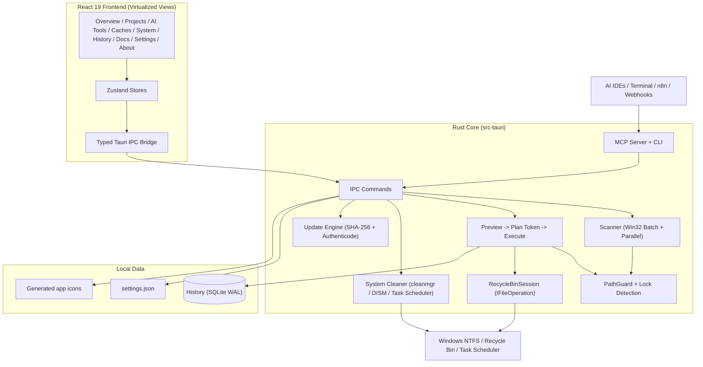

<div align="center">

<a href="https://vellium.dev" target="_blank" rel="noopener noreferrer">
  
</a>

<br /><br />

#  Detergo - Fast, Safe Multi-Ecosystem Developer & AI Agent Cleaner

</div>

---

<div align="center">

[](#english-version)
&nbsp;&nbsp;&nbsp;&nbsp;
[](#turkish-version)

</div>

---

<div align="center">

[](https://github.com/emirtdede/detergo/actions/workflows/ci.yml)


</div>

---

<a id="english-version"></a>

# English Version

<div align="center">
  
  <h3>Detergo - Safe, Local-First Disk Reclaim for Developers, AI Agents & Windows</h3>
  <p><em>Native Rust Scanner, 82 Catalog Rules, 17 AI Agent Providers, 27 Tool Caches, Windows C: Cleaner, Built-in MCP Server, Terminal CLI, 16 Themes + Custom Hex, 73 Languages</em></p>
  <p><strong>Developed &amp; Published by <a href="https://vellium.dev">Vellium</a></strong></p>
</div>

<br>

##  Project Overview

**Detergo (`v1.0.0`)** is an open-source (MIT) desktop application, terminal CLI, and Model Context Protocol (MCP) server for safely reclaiming developer build artifacts, AI coding-agent storage, global package-manager caches, and Windows C: system leftovers. Built with **Tauri 2 (Rust)** and **React 19 (TypeScript)**, every scan, measurement, safety check, and deletion executes natively in Rust (`src-tauri/src/`). The React frontend only holds backend-issued target IDs and renders virtualized views.

Detergo runs **100% locally** with zero telemetry. It makes no background network calls unless you explicitly press **Check for updates** or configure a webhook. Every cleanup follows a two-stage **Preview -> Plan Token -> Execute** flow, defaults to the Windows Recycle Bin, and is written to a local audit history.

For developers, AI coding agents, and automation pipelines, Detergo ships with a **built-in MCP 2025-11-25 server** (`detergo mcp`), a **terminal CLI** (`detergo`) with a console companion (`detergo.com`), a dedicated **in-app Documentation Center**, a **6-step first-launch onboarding**, and a **zero-cost SHA-256 + Authenticode verified update engine**.

> **Documentation:** architecture, CLI/MCP reference, system cleaner, roadmap, and signing guide are indexed under [`docs/`](docs/ARCHITECTURE.md).

---

##  Key Features

###  Native Win32 Performance

- Directory measurement uses `GetFileInformationByHandleEx(FileIdBothDirectoryInfo)` with 64 KiB buffers, accurate NTFS `AllocationSize`, and 16-shard 64-bit `FileId` hardlink deduplication.
- Discovery runs a parallel work-stealing walker over `FindFirstFileExW(FindExInfoBasic, FIND_FIRST_EX_LARGE_FETCH)` with transparent fallback on non-NTFS volumes.
- Verified on Windows 11 x64 (`--release`, synthetic harness): **300,000 files measured in 0.78 s** (61.1x faster than the previous engine), **10,000-project scan in 9.41 s** (2.6x faster), and **cancellation latency of 21 ms**.

###  Zero-Trust Multi-Layer Safety

- `PathGuard` validates raw and canonical ancestor chains against symlink/junction traversal, enforces scan-root containment, blocks OS/system roots without false-blocking project folders, and never follows symlinks, junctions, or unhydrated cloud stubs.
- Real Win32 lock detection (`DELETE` access + `FILE_SHARE_MODE(0)` + BFS child probe) prevents colliding with active builds and IDEs.
- NTFS `FileId` / `(dev, ino)` snapshot verification (`TargetSnapshot`) runs before deletion; reversible deletion uses a warm STA COM `RecycleBinSession` (`IFileOperation`) with zero silent fallback to permanent delete.
- Permanent deletion requires explicit double confirmation and handle-verified unlinking.

###  82 Catalog Rules across 18 Ecosystems

- JavaScript/TypeScript (30 rules), Python (12), Rust, .NET, Java/Kotlin (including Android `.cxx`), Go, PHP, Dart/Flutter, C/C++, Ruby, Elixir, Swift, Godot, Zig, DevOps/IaC (`.terraform`, `.terragrunt-cache`, `cdk.out`, `.aws-sam`, `.serverless`), Haskell, Unity, and Unreal.
- Every rule is evidence-backed and listed with matches and regenerate hints in the in-app **Rule catalog** (`src-tauri/assets/targets.toml`).
- Filter stale artifacts by age across GUI (`>7d`, `>30d`, `>90d`, `>180d`), CLI (`-o 30d`), and MCP (`older_than_days`).

###  17 AI Coding-Agent Providers & 27 Tool Caches

- **Metadata-only** inspection (never reads prompt or file contents) for Antigravity, Claude Code, Claude Desktop, Codex, Cursor, Windsurf, GitHub Copilot, Cline, Roo Code, OpenCode, T3 Code, Aider, Continue, Zed, LM Studio, Trae, Kiro, plus user-defined custom agent roots.
- **27 developer tool cache providers** (26 cleanable + WSL inspection): official CLI actions for `npm`, `pnpm`, `yarn`, `bun`, `pip`, `uv`, `poetry`, `conda`, `nuget`, `go`, `composer`, `flutter`/`pub`, `docker`, `homebrew`, `playwright`/`cypress`, and audited Recycle Bin cleanup for `cargo`, `gradle`, `maven`, `vcpkg`, `huggingface`, `ollama`, `electron`, `vscode`, `jetbrains`, and `android`.
- Opt-in LLM caches (`ollama`, `huggingface`) are skipped during `c all` unless explicitly targeted.

###  Visual Disk Space Treemap & Overview Analytics

- Interactive squarified 2D treemap on the Overview page with real aspect-ratio measurement and a `+N Other` roll-up so percentages always sum to 100% of cleanable space.
- KPI cards for cleanable space, 100% safe reclaim, scanned targets, and lifetime cleaned bytes, plus a unified **Scan everything** action across Projects, AI Tools, Tool Caches, and the C: system cleaner.

###  Windows C: Drive Cleaner & Automation

- System temp, Prefetch, Windows Update leftovers, error reports, Recycle Bin, `cleanmgr`, DISM component store cleanup, and scheduled Task Scheduler automation with on-demand elevation. See [`docs/SYSTEM_CLEANER.md`](docs/SYSTEM_CLEANER.md).

###  Built-in MCP Server, Terminal CLI & Documentation Center

- **MCP 2025-11-25 server (`detergo mcp`)**: protocol negotiation from `2024-11-05`, cursor pagination, concurrent `notifications/cancelled`, and a 3-gate destructive control (`--allow-destructive` + app setting + single-use preview token + `confirm: true`).
- **Terminal CLI (`detergo s`, `c`, `sys`, `hist`)** with a console companion (`detergo.com`) for synchronous stdout/stderr, `-j` JSON output, and strict exit codes (`0`..`4`).
- **SSRF-protected webhooks** with DNS IP pinning, IPv4/IPv6/NAT64 filtering, idempotency keys, retries, and an opt-in **Allow local & LAN webhooks** toggle for self-hosted n8n while permanently blocking cloud metadata endpoints.
- **In-app Documentation Center** with 16 searchable topics, an interactive CLI command builder, and MCP setup snippets for every supported IDE.

###  Settings, Accessibility & Diagnostics

- **Sectioned Settings**: _General_, _Scan limits_, _Notifications_, _Keyboard shortcuts_ (interactive recorder), _Webhook integration_, _Protection list_, _AI agent policy_, _Privacy_, _Software updates_, and _Error log_ (local-only diagnostics with a ZIP support bundle).
- **Accessibility**: interface zoom from 80% to 150% (`Ctrl +` / `Ctrl -` / `Ctrl 0`), high-contrast borders and text, reduced motion, full keyboard navigation, and automated WCAG 2.2 AA verification with Playwright + axe.

###  16 Themes, Custom Hex Studio, Dynamic App Icons & 73 Languages

- **16 built-in themes** (8 dark + 8 light) plus a **Custom Theme Studio**: type or pick any `#RRGGBB` color and Detergo guarantees WCAG 2.2 AA contrast automatically.
- **18 Detergo app icons** (match active theme, custom color, or any of the 16 themes) applied live to the window, taskbar, system tray, and Desktop / Start Menu shortcuts.
- **73 fully translated languages** across UI, docs, legal, CLI, and the NSIS installer language picker, with full **RTL** mirroring (`ar`, `he`, `fa`, `ur`) and zero English leaks enforced in CI.
- **6-step first-launch onboarding**: Language -> Theme -> App icon -> Welcome -> Safety model -> Quick start.

###  Zero-Cost Update Engine

- Reads a static GitHub Releases manifest (`latest-release.json`) with no API rate limit, detects the install channel (Microsoft Store MSIX, Windows installer, portable), downloads to an atomic `.part` file, verifies **SHA-256** and the Windows **Authenticode** signature, and cleans temporary files on failure.
- Updates are always user-initiated; there are no silent background downloads.

---

##  Tech Stack

<div align="center">


</div>

### Runtime & UI

- **Tauri 2.12 (Rust)** - native desktop runtime, tray, window controls, and IPC
- **React 19 + TypeScript 5.7 + Vite 6** - virtualized, typed frontend with generated Rust bindings (`specta`)
- **Zustand** - lightweight state stores for scan, selection, preferences, and UI

### Data & Security

- **Win32 / NTFS APIs** - batch directory I/O, `FileId` deduplication, lock detection
- **STA COM `IFileOperation`** - reversible Recycle Bin deletion
- **SQLite (WAL mode)** - local cleanup, scan, and action audit history
- **SHA-256 + Authenticode** - verified update downloads

### Build, Test & Release

- **Tauri bundler** - NSIS installer (73 languages), MSI, and a single-file Portable build
- **Cargo + Clippy + Rust tests** - 320+ unit and integration tests
- **Vitest + Playwright + axe-core** - 280 frontend tests and WCAG 2.2 AA E2E checks
- **TestSprite Cloud** - 15 AI-driven end-to-end UI scenarios plus native CLI/MCP/Recycle Bin/offline verification
- **GitHub Actions** - CI, cross-platform `cargo check`, release gates, and SignPath-ready signing

---

##  Project Structure

```tree
detergo/
├── .github/                         # CI, issue/PR templates, security policy, contributing guide
├── assets/
│   ├── brand/                       # Canonical Detergo icon, glyph, and icon manifest
│   ├── icons/                       # README section icons
│   └── vellium-banner.svg           # Vellium header banner
├── docs/                            # Architecture, CLI/MCP, system cleaner, roadmap, signing
├── e2e/                             # Playwright + axe accessibility and About tests
├── packaging/                       # MSIX, Scoop, WinGet, and Homebrew manifests
├── public/                          # Static frontend assets and theme boot script
├── scripts/                         # Release, icon, i18n, brand, contrast, and gate tooling
├── src/
│   ├── app/                         # Application shell and navigation
│   ├── components/                  # Primitives, brand marks, layout, window controls
│   ├── features/                    # Overview, Projects, AI Tools, Caches, System, History,
│   │                                #   Docs, Settings, About, Onboarding, Cleanup dialogs
│   ├── lib/                         # Tauri API bridge, i18n (73 locales), theme engine, utils
│   ├── locales/                     # Language catalog
│   ├── stores/                      # Zustand state stores
│   └── types/                       # Typed IPC contracts
├── src-tauri/
│   ├── assets/                      # targets.toml catalog and CLI/tray locale dictionaries
│   ├── nsis/                        # NSIS hooks and 73-language installer packs
│   └── src/                         # Scanner, cleanup, system cleaner, platform, updates, MCP, CLI
├── testsprite-tests/                # Native CLI, MCP, and webhook verification scripts
└── package.json                     # Scripts and v1.0.0 metadata
```

---

##  Architecture & Security Boundaries



**Security model.** Every filesystem decision is made in Rust; the frontend only receives opaque target IDs. A deletion is only possible through a two-stage plan: the preview records an NTFS `FileId` snapshot, and the execute stage re-verifies it together with the single-use plan token before touching anything. Symlinks, junctions, and unhydrated cloud stubs are never followed, protected and system paths are blocked, and locked files are skipped. Webhooks are SSRF-hardened (DNS IP pinning, no-proxy enforcement, cloud metadata always blocked), update downloads are SHA-256 and Authenticode verified, and the app opens no network connection unless you trigger it.

---

##  Storage & Security Schema

| Path / Boundary                   | Protection                               | Contents                                                   |
| :-------------------------------- | :--------------------------------------- | :--------------------------------------------------------- |
| `%APPDATA%\detergo\settings.json` | Atomic write, schema-versioned           | Theme, language, accessibility, protected paths, shortcuts |
| `%APPDATA%\detergo\icons\`        | Atomic write, cache-busting names        | Generated theme-matched Detergo `.ico` files               |
| Local history database            | SQLite WAL                               | Cleanup, scan, and tool-command audit records              |
| `%TEMP%\detergo-updates\`         | `.part` download, SHA-256 + Authenticode | Verified update installers, removed on failure             |
| Frontend <-> Rust IPC             | Typed bindings, opaque target IDs        | Validated commands and events                              |

---

##  CLI & Built-in MCP Server Usage

### Terminal & PowerShell CLI (`detergo`)

```bash
detergo s .                          # Top 20 largest cleanable targets
detergo s D:\Projects -o 30d -m 50M  # Stale targets (>30 days, >=50 MB)
detergo s D:\Projects -t all -j      # Projects + AI + Caches + C: System as JSON
detergo s . -i                       # Interactive numbered Recycle Bin picker
detergo c                            # Measure all 27 developer tool caches
detergo c docker -y                  # Run audited Docker builder/image/container prune
detergo sys quick -n                 # Preview Windows C: quick cleanup
detergo mcp                          # Start read-only/preview MCP stdio server
```

### Model Context Protocol (MCP) Server (`detergo mcp`)

Add Detergo to **Claude Desktop**, **Cursor**, **Antigravity**, **Windsurf**, or **Cline**:

```json
{
  "mcpServers": {
    "detergo": {
      "command": "detergo",
      "args": ["mcp"]
    }
  }
}
```

See [`docs/CLI.md`](docs/CLI.md) for the complete CLI and MCP reference.

---

##  Installation & Usage

### Installing as an end user (from the setup file)

1. Download `Detergo-1.0.0-x64-Setup.exe` (or `Detergo-1.0.0-Portable.exe`) from [GitHub Releases](https://github.com/emirtdede/detergo/releases).
2. Run it. The setup wizard asks for your language first; your Windows display language is preselected out of 73 languages, with English as the fallback.
3. After install, **Detergo** appears in the Start menu.

**SmartScreen on unsigned downloads:** Until free open-source release signing (SignPath Foundation) is activated, Windows may show the blue "Windows protected your PC" prompt on first run. Choose **More info -> Run anyway**. The Microsoft Store (MSIX) build is re-signed by Microsoft and never shows it. See [`docs/SIGNING_AND_DISTRIBUTION.md`](docs/SIGNING_AND_DISTRIBUTION.md).

**Uninstall:** Windows Settings -> Apps -> Detergo -> Uninstall.

### Prerequisites (building from source)

- **Windows 10 (1809+) or Windows 11** (64-bit)
- **Rust (stable) + MSVC Build Tools**, **Node.js 20+**, and npm
- **Git**

### Run from Source

```bash
git clone https://github.com/emirtdede/detergo.git
cd detergo
npm install
npm run tauri dev
```

### Tests & Release Gates

```bash
cargo fmt --manifest-path src-tauri/Cargo.toml -- --check
cargo clippy --manifest-path src-tauri/Cargo.toml --all-targets -- -D warnings
cargo test --manifest-path src-tauri/Cargo.toml
npm run typecheck        # TypeScript
npm test                 # Vitest (280 tests)
npm run check:bindings   # Rust <-> TypeScript IPC contract
npm run check:audit      # Audit invariants (no long dashes, etc.)
npm run check:brand      # Brand and asset consistency
npm run check:contrast   # WCAG 2.2 AA across all themes
npm run check:i18n       # 73-language key parity
npm run check:gates      # Regression and IPC parity gates
npm run test:a11y        # Playwright + axe E2E
```

### Build Installers

```bash
# NSIS setup, MSI, Portable, and CLI companion into release_output/
npm run build:release
```

---

##  Distribution Packages

Build artifacts are produced under `release_output/`:

- **NSIS installer** - `Detergo-1.0.0-x64-Setup.exe` (73-language startup selector)
- **MSI package** - `Detergo-1.0.0-x64.msi`
- **Portable executable** - `Detergo-1.0.0-Portable.exe`
- **CLI console companion** - `detergo.com`
- **Integrity files** - `SHA256SUMS.txt`, `BUILD_INFO.json`, `latest-release.json`
- **Package manifests** - WinGet, Scoop, Homebrew, and MSIX under [`packaging/`](packaging/)

Published builds and release notes are available on the [GitHub Releases](https://github.com/emirtdede/detergo/releases) page.

---

##  License & Publisher

**Open-source software (MIT License).** Copyright © 2026 **Vellium**. See [`LICENSE`](LICENSE) for the full terms.

- **Publisher:** Vellium ([Company Information](https://vellium.dev/en/legal/company-information))
- **Official Website:** [vellium.dev](https://vellium.dev)
- **Legal Hub:** [Privacy Policy](https://vellium.dev/en/legal/privacy) &bull; [Terms of Service](https://vellium.dev/en/legal/terms) &bull; [Support Policy](https://vellium.dev/en/legal/support) &bull; [Security Disclosure](https://vellium.dev/en/legal/security-disclosure) &bull; [KVKK Notice](https://vellium.dev/en/legal/kvkk-notice)
- **Official Emails:** General [contact@vellium.dev](mailto:contact@vellium.dev) &bull; Support [support@vellium.dev](mailto:support@vellium.dev) &bull; Privacy [privacy@vellium.dev](mailto:privacy@vellium.dev) &bull; Legal [legal@vellium.dev](mailto:legal@vellium.dev) &bull; Security [security@vellium.dev](mailto:security@vellium.dev)
- **Official Social & Community Channels:** [GitHub @VelliumHQ](https://github.com/VelliumHQ) &bull; [LinkedIn](https://www.linkedin.com/company/vellium/) &bull; [X @VelliumDev](https://x.com/VelliumDev) &bull; [Product Hunt @vellium](https://www.producthunt.com/@vellium) &bull; [Instagram @velliumdev](https://www.instagram.com/velliumdev/) &bull; [Threads @velliumdev](https://www.threads.com/@velliumdev) &bull; [Reddit u/VelliumDev](https://www.reddit.com/user/VelliumDev/) &bull; [Discord](https://discord.gg/ur9KBZBEdj)

---

<br>

---

<a id="turkish-version"></a>

# Türkçe Versiyon

<div align="center">
  
  <h3>Detergo - Geliştiriciler, Yapay Zekâ Ajanları ve Windows İçin Güvenli, Yerel Öncelikli Disk Temizleme</h3>
  <p><em>Yerel Rust Tarayıcı, 82 Katalog Kuralı, 17 Yapay Zekâ Ajanı, 27 Araç Önbelleği, Windows C: Temizleyici, Yerleşik MCP Sunucusu, Terminal CLI, 16 Tema + Özel Hex Renk, 73 Dil</em></p>
  <p><strong>Geliştirici ve Yayıncı: <a href="https://vellium.dev">Vellium</a></strong></p>
</div>

<br>

##  Proje Genel Bakışı

**Detergo (`v1.0.0`)**, geliştirici derleme artıklarını, yapay zekâ kodlama ajanı depolamalarını, global paket yöneticisi önbelleklerini ve Windows C: sistem kalıntılarını güvenle temizleyen açık kaynaklı (MIT) bir masaüstü uygulaması, terminal CLI aracı ve Model Context Protocol (MCP) sunucusudur. **Tauri 2 (Rust)** ve **React 19 (TypeScript)** ile geliştirilmiştir; tüm tarama, boyut ölçümü, güvenlik denetimi ve silme işlemleri doğrudan Rust çekirdeğinde (`src-tauri/src/`) yürütülür. Arayüz yalnızca arka uç tarafından üretilen hedef kimliklerini tutar.

Detergo **%100 yerel** çalışır ve telemetri toplamaz. **Güncellemeleri denetle** düğmesine basmadığınız veya bir webhook yapılandırmadığınız sürece arka planda ağ bağlantısı kurmaz. Her temizlik, **Önizleme -> Plan Jetonu -> Yürütme** akışından geçer, varsayılan olarak Windows Geri Dönüşüm Kutusu'nu kullanır ve yerel denetim geçmişine yazılır.

Geliştiriciler, yapay zekâ kodlama ajanları ve otomasyon hatları için Detergo; **yerleşik MCP 2025-11-25 sunucusu** (`detergo mcp`), konsol yardımcısı (`detergo.com`) ile **terminal CLI** (`detergo`), **uygulama içi Dokümantasyon Merkezi**, **6 adımlı ilk açılış karşılama rehberi** ve **sıfır maliyetli SHA-256 + Authenticode doğrulamalı güncelleme motoru** ile birlikte gelir.

> **Dokümantasyon:** mimari, CLI/MCP referansı, sistem temizleyici, yol haritası ve imzalama rehberi [`docs/`](docs/ARCHITECTURE.md) altında bulunur.

---

##  Öne Çıkan Özellikler

###  Yerel Win32 Performansı

- 64 KiB tamponlu `GetFileInformationByHandleEx(FileIdBothDirectoryInfo)`, gerçek NTFS `AllocationSize` ve 16 parçalı 64-bit `FileId` hardlink tekilleştirmesi.
- `FindFirstFileExW(FindExInfoBasic, FIND_FIRST_EX_LARGE_FETCH)` üzerinde paralel iş-paylaşım (work-stealing) keşif motoru.
- Windows 11 x64 (`--release`, sentetik test düzeneği) ölçümleri: **300.000 dosya 0,78 sn'de ölçülür** (eski motordan 61,1 kat hızlı), **10.000 projelik tarama 9,41 sn** (2,6 kat hızlı) ve **21 ms iptal tepki süresi**.

###  Çok Katmanlı Sıfır Güven Güvenliği

- `PathGuard` ham ve kanonik üst dizin zincirlerini symlink/junction geçişlerine karşı doğrular, tarama kökü sınırını zorunlu kılar, proje klasörlerini yanlış engellemeden OS/sistem köklerini korur.
- Gerçek Win32 kilit tespiti (`DELETE` erişimi + `FILE_SHARE_MODE(0)` + BFS alt öğe yoklaması) çalışan derleme ve IDE'lerle çakışmayı önler.
- Silmeden önce NTFS `FileId` / `(dev, ino)` anlık görüntü doğrulaması (`TargetSnapshot`); geri alınabilir silme sıcak STA COM `RecycleBinSession` (`IFileOperation`) ile yapılır ve kalıcı silmeye sessiz geri dönüş yoktur.
- Kalıcı silme açık çift onay gerektirir.

###  18 Ekosistemde 82 Katalog Kuralı

- JavaScript/TypeScript (30 kural), Python (12), Rust, .NET, Java/Kotlin, Go, PHP, Dart/Flutter, C/C++, Ruby, Elixir, Swift, Godot, Zig, DevOps/IaC (Terraform, Terragrunt, AWS CDK/SAM, Serverless), Haskell, Unity ve Unreal.
- Her kural kanıta dayalıdır; uygulama içi **Kural kataloğu** eşleşmeleri ve yeniden üretim ipuçlarıyla birlikte listeler.
- Eski artıkları yaşa göre filtreleme: arayüz (`>7g`, `>30g`, `>90g`, `>180g`), CLI (`-o 30d`) ve MCP (`older_than_days`).

###  17 Yapay Zekâ Ajanı ve 27 Araç Önbelleği

- Yalnızca **metaveri** incelemesi (istem veya dosya içeriğini asla okumaz): Antigravity, Claude Code/Desktop, Codex, Cursor, Windsurf, GitHub Copilot, Cline, Roo Code, OpenCode, T3 Code, Aider, Continue, Zed, LM Studio, Trae, Kiro ve kullanıcı tanımlı özel ajan kökleri.
- **27 geliştirici aracı önbelleği** (26 temizlenebilir + WSL incelemesi): `npm`, `pnpm`, `yarn`, `bun`, `pip`, `uv`, `poetry`, `conda`, `nuget`, `go`, `composer`, `flutter`/`pub`, `docker`, `homebrew`, `playwright`/`cypress` için resmi CLI aksiyonları ve `cargo`, `gradle`, `maven`, `vcpkg`, `huggingface`, `ollama`, `electron`, `vscode`, `jetbrains`, `android` için denetimli Geri Dönüşüm Kutusu temizliği.

###  Görsel Disk Treemap ve Genel Bakış İstatistikleri

- Genel Bakış sayfasında gerçek en-boy oranlı etkileşimli 2D Treemap ve yüzdelerin her zaman %100 etmesini sağlayan `+N Diğer` dilimi.
- Temizlenebilir alan, %100 güvenli geri kazanım, taranan hedefler ve toplam temizlenen boyut KPI kartları ile Projeler, AI Araçları, Araç Önbellekleri ve C: sistem temizleyicisini birlikte tarayan **Tümünü tara** eylemi.

###  Windows C: Sürücü Temizleyici ve Otomasyon

- Sistem geçici dosyaları, Prefetch, Windows Update artıkları, hata raporları, Geri Dönüşüm Kutusu, `cleanmgr`, DISM bileşen deposu temizliği ve isteğe bağlı yükseltmeli Görev Zamanlayıcı otomasyonu. Ayrıntılar için [`docs/SYSTEM_CLEANER.md`](docs/SYSTEM_CLEANER.md).

###  Yerleşik MCP Sunucusu, Terminal CLI ve Dokümantasyon Merkezi

- **MCP 2025-11-25 sunucusu (`detergo mcp`)**: `2024-11-05` sürümünden başlayan protokol müzakeresi, cursor sayfalama, eşzamanlı `notifications/cancelled` ve 3 kapılı yıkıcı işlem kontrolü (`--allow-destructive` + uygulama ayarı + tek kullanımlık önizleme jetonu + `confirm: true`).
- **Terminal CLI (`detergo s`, `c`, `sys`, `hist`)** ve senkron stdout/stderr, `-j` JSON çıktısı ve katı çıkış kodları (`0`..`4`) için konsol yardımcısı (`detergo.com`).
- **SSRF korumalı webhook'lar**: DNS IP sabitleme, IPv4/IPv6/NAT64 filtreleme, idempotency anahtarları, yeniden deneme ve yerel n8n için isteğe bağlı **Yerel ve LAN webhook'larına izin ver** anahtarı; bulut metadata adresleri daima engelli.
- **Uygulama içi Dokümantasyon Merkezi**: 16 aranabilir konu, etkileşimli CLI komut oluşturucu ve desteklenen her IDE için MCP kurulum örnekleri.

###  Ayarlar, Erişilebilirlik ve Tanılama

- **Bölümlü Ayarlar**: _Genel_, _Tarama limitleri_, _Bildirimler_, _Klavye kısayolları_ (canlı kaydedici), _Webhook entegrasyonu_, _Koruma listesi_, _AI ajan politikası_, _Gizlilik_, _Yazılım güncellemeleri_ ve _Hata günlüğü_ (yalnızca yerel tanılama ve ZIP destek paketi).
- **Erişilebilirlik**: %80 ile %150 arası arayüz yakınlaştırma (`Ctrl +` / `Ctrl -` / `Ctrl 0`), yüksek kontrastlı kenarlık ve metinler, hareketi azaltma, tam klavye gezinmesi ve Playwright + axe ile otomatik WCAG 2.2 AA doğrulaması.

###  16 Tema, Özel Hex Stüdyosu, Dinamik Uygulama İkonları ve 73 Dil

- **16 yerleşik tema** (8 koyu + 8 açık) ve **Özel Tema Stüdyosu**: istediğiniz `#RRGGBB` rengini yazın veya seçin; Detergo WCAG 2.2 AA kontrastını otomatik garanti eder.
- **18 Detergo uygulama ikonu** (aktif temayla uyumlu, özel renkli veya 16 temadan biri) pencere, görev çubuğu, sistem tepsisi ve Masaüstü / Başlat Menüsü kısayollarına anında uygulanır.
- Arayüz, dokümanlar, yasal metinler, CLI ve NSIS kurulum dil seçicisinde **73 tam çevrilmiş dil**, tam **RTL** desteği (`ar`, `he`, `fa`, `ur`) ve CI'da zorunlu sıfır İngilizce sızıntısı.
- **6 adımlı ilk açılış karşılama rehberi**: Dil -> Tema -> Uygulama ikonu -> Hoş geldiniz -> Güvenlik modeli -> Hızlı başlangıç.

###  Sıfır Maliyetli Güncelleme Motoru

- API hız sınırı olmayan statik GitHub Releases bildirimini (`latest-release.json`) okur, kurulum kanalını (Microsoft Store MSIX, Windows kurulumu, taşınabilir) algılar, atomik `.part` dosyasına indirir, **SHA-256** ve **Authenticode** imzasını doğrular ve hata durumunda geçici dosyaları temizler.
- Güncellemeler daima kullanıcı tarafından başlatılır; sessiz arka plan indirmesi yoktur.

---

##  Kurulum ve Kullanım

### Son kullanıcı için kurulum (kurulum dosyasından)

1. [GitHub Releases](https://github.com/emirtdede/detergo/releases) sayfasından `Detergo-1.0.0-x64-Setup.exe` (veya taşınabilir `Detergo-1.0.0-Portable.exe`) dosyasını indirin.
2. Çalıştırın. Kurulum sihirbazı önce dil sorar; Windows görüntüleme diliniz 73 dil arasından otomatik seçilir, listede yoksa İngilizce kullanılır.
3. Kurulumdan sonra Başlat menüsünde **Detergo** görünür.

**Kaldırma:** Windows Ayarlar -> Uygulamalar -> Detergo -> Kaldır.

### Kaynaktan Çalıştırma ve Derleme

```bash
git clone https://github.com/emirtdede/detergo.git
cd detergo
npm install
npm run tauri dev

# Test ve Sürüm Kapıları
cargo test --manifest-path src-tauri/Cargo.toml
npm run typecheck
npm test
npm run check:gates
npm run test:a11y

# Kurulum, MSI ve Taşınabilir Paket Derleme (v1.0.0)
npm run build:release
```

---

##  Lisans ve Yayıncı

**Açık kaynak yazılım (MIT Lisansı).** Copyright © 2026 **Vellium**. Tam koşullar için [`LICENSE`](LICENSE) dosyasına bakın.

- **Yayıncı:** Vellium ([Şirket Bilgileri](https://vellium.dev/tr/yasal/sirket-bilgileri))
- **Resmi Web Sitesi:** [vellium.dev](https://vellium.dev)
- **Yasal Merkez:** [Gizlilik Politikası](https://vellium.dev/tr/yasal/gizlilik-politikasi) &bull; [Hizmet Koşulları](https://vellium.dev/tr/yasal/hizmet-kosullari) &bull; [Destek Politikası](https://vellium.dev/tr/yasal/destek-politikasi) &bull; [Güvenlik Açığı Bildirimi](https://vellium.dev/tr/yasal/guvenlik-acigi-bildirimi) &bull; [KVKK Aydınlatma Metni](https://vellium.dev/tr/yasal/kvkk-aydinlatma-metni)
- **Resmi E-Posta Kanalları:** Genel [contact@vellium.dev](mailto:contact@vellium.dev) &bull; Destek [support@vellium.dev](mailto:support@vellium.dev) &bull; Gizlilik [privacy@vellium.dev](mailto:privacy@vellium.dev) &bull; Hukuk [legal@vellium.dev](mailto:legal@vellium.dev) &bull; Güvenlik [security@vellium.dev](mailto:security@vellium.dev)
- **Resmi Sosyal Medya ve Topluluk Hesapları:** [GitHub @VelliumHQ](https://github.com/VelliumHQ) &bull; [LinkedIn](https://www.linkedin.com/company/vellium/) &bull; [X @VelliumDev](https://x.com/VelliumDev) &bull; [Product Hunt @vellium](https://www.producthunt.com/@vellium) &bull; [Instagram @velliumdev](https://www.instagram.com/velliumdev/) &bull; [Threads @velliumdev](https://www.threads.com/@velliumdev) &bull; [Reddit u/VelliumDev](https://www.reddit.com/user/VelliumDev/) &bull; [Discord](https://discord.gg/ur9KBZBEdj)
