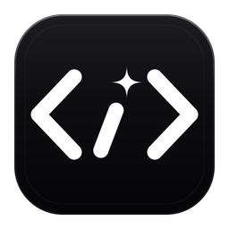

<div align="center">



# Detergo - Fast, Safe Multi-Ecosystem Developer & AI Agent Cleaner

[](LICENSE)


[English](#english) · [Türkçe](#turkce) · [Architecture](docs/ARCHITECTURE.md) · [CLI & MCP Reference](docs/CLI.md) · [Roadmap](docs/ROADMAP.md) · [Changelog](docs/CHANGELOG.md)

</div>

---

<a id="english"></a>

## English

**Detergo** is an open-source (MIT) desktop application, terminal CLI, and Model Context Protocol (MCP) server built with **Tauri 2 (Rust)** and **React 19 (TypeScript)** for safely reclaiming developer build artifacts, AI coding-agent storage, global package-manager caches, and Windows C: system leftovers.

All scanning, measurement, safety enforcement, and deletion execute natively in Rust (`src-tauri/src/`). The React frontend holds only backend-issued target IDs and renders virtualized views. Detergo runs **100% locally** with zero telemetry and makes no background network calls unless you explicitly press **Check for updates** or configure a webhook.

### Verified Performance Benchmarks (Windows 11 x64, `--release`)

Measured on Windows 11 x64 NTFS using the reproducible synthetic harness included in this repository (`npm run bench:measure` and `npm run bench:scale` - synthetic directory trees with deterministic sizes; real-world timings depend on SSD/HDD hardware, antivirus scanning, and OS cache warmth):

| Benchmark                                                               | Previous Engine (`WalkDir`) | Current Engine (Win32 Batch + Parallel) | Speedup / Notes                                                                |
| :---------------------------------------------------------------------- | :-------------------------: | :-------------------------------------: | :----------------------------------------------------------------------------- |
| **300,000-file directory measurement** (`NC_RECORDINGS=300000`)         |           47.7 s            |          **0.78 s (`781 ms`)**          | **61.1× faster**, `10.6 MB` peak RSS, exact byte match (`307,200,000 B`)       |
| **10,000-project full scan** (`NC_BENCH_CANDIDATES=10000`, 70k entries) |           24.5 s            |         **9.41 s (`9,411 ms`)**         | **2.6× faster**, `77.5 MB` peak RSS, full manifest + safety + size measurement |
| **Cancellation latency** (`NC_CANCEL_CANDIDATES=20000`)                 |              -              |               **`21 ms`**               | Instant abort with clean partial summary                                       |

### What Makes Detergo Different

- **Native Win32 Batch I/O**: Directory measurement uses `GetFileInformationByHandleEx(FileIdBothDirectoryInfo)` with 64 KiB buffers, accurate NTFS `AllocationSize`, and 16-shard 64-bit NTFS `FileId` hardlink deduplication; discovery runs a parallel work-stealing walker over `FindFirstFileExW(FindExInfoBasic, FIND_FIRST_EX_LARGE_FETCH)` with transparent `WalkDir` fallback on non-NTFS volumes.
- **Zero-Trust Multi-Layer Safety**:
  - `PathGuard` validates both raw and canonical ancestor chains against symlink/junction traversal, enforces canonical scan-root containment, blocks OS/system roots (without false-blocking project folders like `flutter-app/windows/build` or `spring/boot/target`), and never follows symlinks, junctions, or unhydrated cloud stubs.
  - Real Win32 lock detection (`DELETE` access + `FILE_SHARE_MODE(0)` + BFS child probe) prevents colliding with active builds/IDEs.
  - Two-stage **Preview → Plan Token → Execute** verifies NTFS `FileId` / `(dev, ino)` (`TargetSnapshot`) before deletion and logs every run to local WAL-mode SQLite audit history.
  - Reversible deletion uses a warm STA COM `RecycleBinSession` (`IFileOperation`, zero silent fallback to permanent delete) on Windows, Finder on macOS, and `gio trash` on Linux; permanent deletion uses handle-verified parallel POSIX unlinking with explicit double confirmation.
- **82 Evidence-Backed Catalog Rules across 18 Ecosystems**: Covers JavaScript/TypeScript (30 rules, including `.expo`, `.wrangler`, `.open-next`, `.docusaurus`, `playwright-report`, `test-results`), Python (12 rules, including `*.egg-info`, `.ipynb_checkpoints`, `.hypothesis`), Rust, .NET, Java/Kotlin (including Android `.cxx`), Go, PHP, Dart/Flutter, C/C++ (including `.vs`, `vcpkg_installed`), Ruby, Elixir, Swift (including `Pods`, `Carthage`), Godot (including `.import`), Zig, DevOps/IaC (`.terraform`, `.terragrunt-cache`, `cdk.out`, `.aws-sam`, `.serverless`), Haskell (`.stack-work`, `dist-newstyle`), Unity, and Unreal (`src-tauri/assets/targets.toml`).
- **27 Developer Tool Cache Providers (26 Cleanable + WSL Inspection)**: Native official CLI actions for `npm`, `pnpm`, `yarn`, `bun`, `pip`, `uv`, `poetry`, `conda`, `nuget`, `go` (`-cache` & `-modcache`), `composer`, `flutter`/`pub`, `docker` (`builder`, `image`, and `container prune`), `homebrew`, `playwright`/`cypress` (`npx --no-install`), plus audited Recycle Bin cleanup (`SafeCacheRecycle`) for `cargo` (`registry/cache`, `registry/src`, `git/checkouts`), `gradle`, `maven`, `vcpkg`, `huggingface`, `ollama`, `electron`, `vscode`, `jetbrains` (excluding Toolbox), and `android`, plus real registry-backed sparse `ext4.vhdx` measurement for **WSL** (read-only). Opt-in LLM caches (`ollama`, `huggingface`) are skipped during `c all` unless explicitly targeted.
- **17 Built-in AI Coding-Agent Providers**: Metadata-only inspection (never reads prompt/file contents) for **Antigravity**, **Claude Code**, **Claude Desktop**, **Codex**, **Cursor**, **Windsurf**, **GitHub Copilot**, **Cline**, **Roo Code**, **OpenCode**, **T3 Code**, **Aider**, **Continue**, **Zed**, **LM Studio**, **Trae**, **Kiro**, plus user-defined custom agent roots.
- **Visual Disk Space Treemap & Staleness Filters**:
  - Interactive squarified 2D treemap on the Overview page with real aspect-ratio measurement and a `"+N Other"` roll-up so percentages always sum to 100% of cleanable space.
  - Filter stale artifacts by age across GUI (`>7d`, `>30d`, `>90d`, `>180d`), CLI (`-o 30d` / `--older 3m`), and MCP (`older_than_days`).
- **Windows C: Drive Cleaner & Automation**: Built-in system temp, Prefetch, Windows Update leftovers, error reports, Recycle Bin, `cleanmgr`, DISM component store cleanup, and scheduled Task Scheduler automation with on-demand elevation. See [`docs/SYSTEM_CLEANER.md`](docs/SYSTEM_CLEANER.md).
- **CLI + Console Companion + MCP 2025-11-25 Server + Webhooks**:
  - Concise CLI (`detergo s`, `c`, `sys`, `hist`) plus a dedicated console companion (`detergo.com`) for synchronous terminal stdout/stderr, `-j` JSON output, and strict exit codes (`0`..`4`).
  - Built-in stdio MCP server (`detergo mcp`) supporting protocol versions `2024-11-05` through `2025-11-25`, cursor pagination, concurrent `notifications/cancelled` handling, and 3-gate destructive control (`--allow-destructive` + app setting + single-use preview token + `confirm: true`).
  - SSRF-protected webhooks with DNS IP pinning, IPv4/IPv6/NAT64 filtering, no-proxy enforcement, idempotency keys, retries, and an opt-in **Allow local & LAN webhooks** toggle for self-hosted n8n (`http://localhost:5678`) while permanently blocking cloud metadata (`169.254.0.0/16`, `fe80::/10`, `metadata.google.internal`).
- **73 Fully Translated Languages & 16 WCAG 2.2 AA Themes**: Zero untranslated English leaks across all 73 UI, docs, legal, and CLI locales, full RTL support (`ar`, `he`, `fa`, `ur`), localized NSIS installer, and automated contrast verification across all 16 themes.

### Quick Start (CLI)

```bash
detergo s .                         # Top 20 largest cleanable targets
detergo s D:\Projects -o 30d -m 50M # Stale targets (>30 days, >=50 MB)
detergo s D:\Projects -t all -j     # Projects + AI + Caches + C: System as JSON
detergo s . -i                      # Interactive numbered Recycle Bin picker
detergo c                           # Measure all 27 developer tool caches
detergo c docker -y                 # Run audited Docker builder/image/container prune
detergo sys quick -n                # Preview Windows C: quick cleanup
detergo mcp                         # Start read-only/preview MCP stdio server
```

See [`docs/CLI.md`](docs/CLI.md) for the complete CLI/MCP reference, [`docs/ARCHITECTURE.md`](docs/ARCHITECTURE.md) for technical internals, [`docs/SYSTEM_CLEANER.md`](docs/SYSTEM_CLEANER.md) for Windows C: drive maintenance, and [`docs/SIGNING_AND_DISTRIBUTION.md`](docs/SIGNING_AND_DISTRIBUTION.md) for WinGet/Scoop packaging and code signing.

### Development & Verification

```bash
npm install
npm run tauri dev          # Desktop development mode

# Full verification gates (328 Rust tests + 271 frontend tests + Playwright E2E + CI gates)
cargo fmt --manifest-path src-tauri/Cargo.toml -- --check
cargo clippy --manifest-path src-tauri/Cargo.toml --all-targets -- -D warnings
cargo test --manifest-path src-tauri/Cargo.toml
npm run typecheck
npm test
npm run check:bindings
npm run check:audit
npm run check:brand
npm run check:contrast
npm run check:i18n
npm run build
npm run check:gates
npm run test:a11y
```

### Platform Support & Transparent Status

- **Windows 11 x64 (Full Support)**: Native NTFS batch I/O, STA COM Recycle Bin, C: System Cleaner (`cleanmgr`/DISM/Task Scheduler), dual `detergo.exe` + `detergo.com` console companion, NSIS/MSI/Portable packages, and WinGet/Scoop manifests (`packaging/`).
- **macOS & Linux (Cross-Platform Core Verified in CI)**: Core Rust engine (project scanner, 17 AI tools, cross-platform cache providers including Homebrew/VS Code/JetBrains/Android, CLI, MCP, Finder/`gio trash`, POSIX process/drive inspection) is continuously verified via `cargo check` and unit tests on `ubuntu-latest` and `macos-latest` in GitHub Actions; native `.dmg`/`.AppImage` installers are planned next.
- **Code Signing Policy**: Release builds are ready for free open-source Authenticode signing via **SignPath Foundation** (`signpath/github-action-submit-signing-request@v3` wired in `.github/workflows/ci.yml`, activated automatically once `SIGNPATH_API_TOKEN` is configured). Read our public [Code Signing Policy & Distribution Guide](docs/SIGNING_AND_DISTRIBUTION.md#1-code-signing-policy-signpath-foundation).
- **Release Updates**: Update checking (`Settings → Updates`) is user-initiated, verifies release URLs strictly against this GitHub repository, compares SemVer 2.0.0 pre-release tags accurately, and opens the release page without silent background downloads.

---

<a id="turkce"></a>

## Türkçe

**Detergo**, **Tauri 2 (Rust)** ve **React 19 (TypeScript)** ile geliştirilmiş, açık kaynaklı (MIT) bir masaüstü uygulaması, terminal CLI aracı ve yerleşik MCP sunucusudur. Geliştirici derleme artıklarını, yapay zekâ kodlama ajanı depolamalarını, global paket yöneticisi önbelleklerini ve Windows C: sistem kalıntılarını güvenli ve doğrulanabilir şekilde temizler.

Tüm tarama, boyut ölçümü, güvenlik denetimi ve silme işlemleri doğrudan Rust çekirdeğinde (`src-tauri/src/`) yürütülür. **%100 yerel** çalışır; telemetri veya analitik toplamaz, siz açıkça tetiklemediğiniz sürece dış ağ bağlantısı kurmaz.

### Doğrulanmış Performans Ölçümleri (Windows 11 x64, `--release`)

| Benchmark                                                                | Eski Motor (`WalkDir`) | Yeni Motor (Win32 Batch + Paralel) | Hızlanma / Not                                                                  |
| :----------------------------------------------------------------------- | :--------------------: | :--------------------------------: | :------------------------------------------------------------------------------ |
| **300.000 dosyalık dizin ölçümü** (`NC_RECORDINGS=300000`)               |        47,7 sn         |       **0,78 sn (`781 ms`)**       | **61,1× daha hızlı**, `10,6 MB` tepe RAM, birebir bayt eşleşmesi                |
| **10.000 projelik tam tarama** (`NC_BENCH_CANDIDATES=10000`, 70 bin öğe) |        24,5 sn         |      **9,41 sn (`9.411 ms`)**      | **2,6× daha hızlı**, `77,5 MB` tepe RAM, tam manifest + güvenlik + boyut ölçümü |
| **İptal tepki süresi** (`NC_CANCEL_CANDIDATES=20000`)                    |           -            |            **`21 ms`**             | Anında durdurma ve temiz kısmi özet                                             |

### Öne Çıkan Mimari Özellikler

- **Yerel Win32 Toplu I/O**: Dizin ölçümü 64 KiB tamponlu `GetFileInformationByHandleEx(FileIdBothDirectoryInfo)` + 16 parçalı 64-bit NTFS `FileId` hardlink tekilleştirmesi kullanır; keşif aşaması `FindFirstFileExW(FindExInfoBasic, FIND_FIRST_EX_LARGE_FETCH)` üzerinde paralel iş-paylaşım (work-stealing) havuzuyla çalışır.
- **Çok Katmanlı Güvenlik**: `PathGuard` kanonik kök sınır denetimi (`flutter-app/windows/build` gibi proje alt dizinlerini yanlış engellemeden OS köklerini korur), gerçek Win32 dosya kilidi tespiti (`DELETE` + `FILE_SHARE_MODE(0)`), NTFS `FileId` anlık görüntü doğrulaması, sıcak STA COM `RecycleBinSession` ile geri alınabilir Çöp Kutusu silimi ve yerel SQLite denetim günlüğü.
- **82 Kanıta Dayalı Kural, 18 Ekosistem, 27 Araç Önbelleği ve 17 Yapay Zekâ Aracı**: JS/TS, Python, Rust, .NET, Java/Kotlin, Go, PHP, Dart/Flutter, C/C++, Ruby, Elixir, Swift, Godot, Zig, DevOps/IaC (Terraform, Terragrunt, AWS CDK/SAM, Serverless), Haskell, Unity ve Unreal kuralları; `docker`, `cargo`, `gradle`, `maven`, `vcpkg`, `huggingface`, `ollama`, `electron`, `vscode`, `jetbrains`, `android`, `homebrew`, `go`, `npm`/`pnpm`/`yarn`/`bun`, `pip`/`uv`/`poetry`/`conda`, `nuget`, `composer`, `flutter`/`pub`, `playwright`/`cypress` için gerçek temizleme aksiyonları; 17 yerleşik AI kodlama aracı taraması (Antigravity, Claude Code/Desktop, Codex, Cursor, Windsurf, Copilot, Cline, Roo Code, OpenCode, T3 Code, Aider, Continue, Zed, LM Studio, Trae, Kiro) ve WSL `ext4.vhdx` ölçümü.
- **Görsel Disk Treemap ve Yaş (Staleness) Filtresi**: Genel Bakış sayfasında gerçek en-boy oranlı 2D Treemap haritası ve `+N Diğer` dilimi; arayüzde (`>7g`, `>30g`, `>90g`, `>180g`), CLI'da (`-o 30d` / `--older 3m`) ve MCP'de (`older_than_days`) kullanılmayan eski artıkları filtreleme.
- **CLI (`detergo.com`), MCP 2025-11-25 Sunucusu ve Self-Hosted Webhook**: `detergo mcp` için protokol müzakeresi, cursor sayfalama, gerçek zamanlı iptal ve 3 bağımsız yıkıcı işlem kapısı; yerel n8n (`http://localhost:5678`) için isteğe bağlı LAN webhook izni (bulut metadata IP'leri, NAT64 ve IPv6 eşlemeleri daima engelli).
- **73 Tam Çevrilmiş Dil, 16 WCAG 2.2 AA Tema ve Otomatik Kalite Kapıları**: 328 Rust testi, 271 frontend testi, Playwright + axe E2E doğrulaması, sıfır Clippy uyarısı, sıfır çevrilmemiş İngilizce sızıntısı ve Linux/macOS çapraz platform CI derlemesi.

### Lisans

MIT Lisansı - Telif Hakkı &copy; 2026 Vellium. Ayrıntılar için [`LICENSE`](LICENSE) dosyasına bakın.
