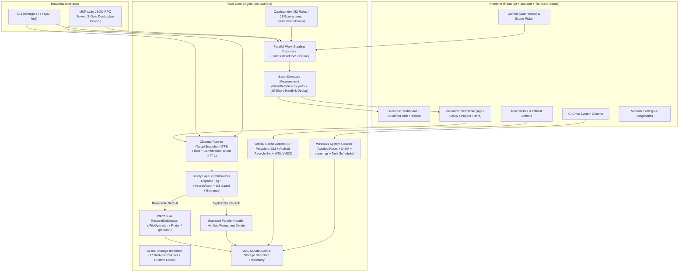

# Detergo - Architecture

Detergo is a **Tauri 2 (Rust) + React 19 (TypeScript)** desktop application, CLI tool, and Model Context Protocol (MCP) server for safely reclaiming developer build artifacts, AI coding-agent storage, global package-manager caches, and Windows C: system leftovers.

All scanning, filesystem measurement, safety validation, and deletion execute in the Rust backend (`src-tauri/src/`). The React frontend (`src/`) holds only backend-issued target IDs and renders virtualized views over streamed events.

---

## Core Architecture Diagram

---

## Backend Subsystems (`src-tauri/src/`)

### 1. Platform & Fast Filesystem Layer (`platform/`)
- **Windows Batch Directory Measurement (`platform/windows/fast_walk.rs`)**:
  - Uses `GetFileInformationByHandleEx(FileIdBothDirectoryInfo)` with a 64 KiB aligned buffer per directory.
  - Reads `EndOfFile`, attributes, `EaSize` reparse tags, and 64-bit NTFS `FileId` in bulk without per-file `CreateFileW` handles.
  - Deduplicates hardlinks across 16 lock-sharded `HashSet<u64>` tables (`hardlink_dedup_bytes`) and fans out subdirectories across bounded worker threads via `std::thread::scope` + `crossbeam_channel`.
  - Falls back to `WalkDir` transparently on non-NTFS / unsupported volumes (FAT32, network shares).
- **Windows Fast Directory Enumeration (`read_dir_fast`)**:
  - Uses `FindFirstFileExW(FindExInfoBasic, FIND_FIRST_EX_LARGE_FETCH)` returning `dwFileAttributes`, `dwReserved0` reparse tag, and `ftLastWriteTime` in one pass.
- **Lock & Metadata Inspection (`platform/windows/fs_meta.rs`)**:
  - `is_in_use(path)` attempts a real `DELETE`-access open with `FILE_SHARE_MODE(0)` (and probes up to 48 nested files / depth 2 for directories) to detect active locks before cleanup.
  - Unix fallback implementations use `std::os::unix::fs::MetadataExt` (`dev`, `ino`, `blocks`).
- **Atomic File Persistence (`platform/mod.rs`)**:
  - Shared `atomic_replace_file` (`MoveFileExW(MOVEFILE_REPLACE_EXISTING | MOVEFILE_WRITE_THROUGH)` on Windows; `fs::rename` on Unix) used by both `settings/repository.rs` and `system_cleaner/schedule.rs`.

### 2. Scanner (`scanner/`)
- **Parallel Work-Stealing Discovery (`scanner/discovery.rs`)**:
  - Uses 2-8 worker threads over `std::thread::scope` + `crossbeam_channel`, each maintaining a thread-local `ProjectResolver` and `git_repo_cache`.
  - Enforces atomic candidate limits, depth limits, drive-root OS exclusions, reparse-point safety (allowing transparent WOF/Dedup/hydrated cloud folders while blocking symlinks, junctions, and unhydrated stubs), and `GitPolicy::DenyTracked` checks.
- **Parallel Measurement (`scanner/measurement.rs`)**:
  - Bounded worker pool (`MeasurementEngine`) calling `measure_dir_fast` with `max_workers = 1` per candidate to prevent nested oversubscription, streaming `MeasurementUpdate` batches over Tauri channels.

### 3. Multi-Layer Safety (`safety/` & `cleanup/`)
- **PathGuard (`safety/path_guard.rs`)**: Canonicalizes paths, verifies containment inside scan roots, blocks drive roots, user profile roots, OS system trees (`Windows`, `Boot`, `Recovery` at drive root; `Program Files`, `ProgramData`, `System32`, `SysWOW64`, `$Recycle.Bin`, etc. at any depth; `AppData\Windows`), and Unix system directories (`/bin`, `/etc`, `/usr`, `/System`, etc.) without false-blocking developer project subdirectories like `flutter-app/windows/build` or `spring-app/boot/target`.
- **Two-Stage Plan → Execute (`cleanup/plan.rs`, `cleanup/coordinator.rs`)**:
  - Captures NTFS `FileId` / `(dev, ino)` `TargetSnapshot` at preview time and verifies identity immediately prior to deletion (eliminating redundant synchronous directory re-walks while preserving TOCTOU protection).
  - **Recycle Bin (`cleanup/recycle_bin.rs`)**: Reuses a single warm STA COM worker (`RecycleBinSession`) across an entire cleanup batch on Windows (`IFileOperation` with `FOFX_RECYCLEONDELETE`, zero silent fallback to permanent delete). Uses Finder AppleScript on macOS and `gio trash` on Linux.
  - **Permanent Delete (`cleanup/permanent.rs`)**: Handle-verified POSIX unlink (`FILE_DISPOSITION_INFO_EX`) with bounded parallel leaf-file deletion (`>= 64` files → up to 8 workers) and bottom-up directory removal.

### 4. Catalog, AI Providers & Official Tool Caches (`catalog/`, `providers/`, `cleanup/official_actions/`)
- **Cleanup Catalog (`assets/targets.toml`)**: 82 evidence-backed rules across 18 ecosystems spanning JavaScript/TypeScript, Python, Rust, .NET, Java/Kotlin, Go, PHP, Dart/Flutter, C/C++, Ruby, Elixir, Swift, Godot, Zig, DevOps/IaC, Haskell, Unity, and Unreal.
- **AI Coding-Agent Providers (`providers/`)**: 17 built-in providers (`antigravity`, `claude-code`, `claude-desktop`, `codex`, `cursor`, `windsurf`, `github-copilot`, `cline`, `roo-code`, `opencode`, `t3-code`, `aider`, `continue`, `zed`, `lm-studio`, `trae`, `kiro`) with cross-platform root resolution, metadata-only scanning, and aggregated storage-growth snapshots.
- **Tool Cache Providers (`cleanup/official_actions/`)**: 27 providers (`catalog.rs`, `wsl.rs`, `exec.rs`, `mod.rs`):
  - Native CLI cleanup commands for `npm`, `pnpm`, `yarn`, `bun`, `pip`, `uv`, `poetry`, `conda`, `nuget`, `go` (`go clean -cache` & `go clean -modcache`), `composer`, `flutter`/`pub`, `docker` (`docker builder prune -f`, `docker image prune -f`, `docker container prune -f`), `homebrew`, `playwright` (`npx --no-install`), and `cypress` (`npx --no-install`).
  - Audited Recycle Bin cache cleanup (`SafeCacheRecycle`, guarded by `PathGuard` + active-process checks) for `cargo` (`registry/cache`, `registry/src`, `git/checkouts`), `gradle`, `maven`, `vcpkg`, `huggingface`, `ollama`, `electron`, `vscode`, `jetbrains` (safely excluding Toolbox), `android`, and Playwright/Cypress browser caches. Opt-in LLM caches (`ollama`, `huggingface`) are excluded from bulk `c all` runs unless explicitly selected.
  - Real Windows registry WSL VHDX inspection (`HKCU\Software\Microsoft\Windows\CurrentVersion\Lxss\*` + `%LOCALAPPDATA%\wsl\*\ext4.vhdx`, measuring sparse allocated bytes), intentionally read-only.

### 5. Automation, Webhooks & MCP (`cli/`, `mcp/`, `commands/webhook_commands.rs`)
- **CLI (`cli/` & `bin/detergo_cli.rs`)**: Modular subcommands (`args.rs`, `scan.rs`, `caches.rs`, `history.rs`, `help.rs`, `i18n.rs`) plus a console-subsystem companion binary (`detergo.com`) for synchronous Windows terminal pipes, `--flag=value` and `--` parsing, staleness filtering (`-o` / `--older`), human-readable size thresholds (`-m`), interactive picker (`-i`), JSON output (`-j`), and strict automation exit codes (`0`..`4`).
- **MCP Server (`mcp/`)**: Modular stdio JSON-RPC server (`tools.rs`, `handlers_scan.rs`, `handlers_cache.rs`, `handlers_system.rs`) supporting protocol negotiation (`2024-11-05` through `2025-11-25`), 2 MiB line cap, concurrent request workers with `notifications/cancelled` cancellation, cursor pagination (`cursor`/`limit`/`nextCursor`), and 3 independent destructive gates: CLI `--allow-destructive`, saved `mcpAllowDestructive` setting, and single-use preview token + `confirm: true`.
- **SSRF-Protected Webhooks (`commands/webhook_commands.rs`)**: DNS IP pinning, `no_proxy()`, trailing-dot host normalization, IPv4/IPv6/NAT64 filtering, no HTTP redirects, idempotency keys, and 3-attempt exponential retry on 429/5xx. Strict public-only by default; opt-in `allowPrivateWebhooks` permits self-hosted loopback/LAN targets (e.g. local n8n) while permanently blocking cloud metadata (`169.254.0.0/16`, `fe80::/10`, `metadata.google.internal`), `0.0.0.0`, `::`, and multicast.

---

## Frontend Architecture (`src/`)

- **IPC Type Contract**: Generated via `specta` (`npm run generate:bindings` → `src/lib/tauri/bindings.ts`) and verified against `src/types/index.ts` in `src/test/bindings-contract.test.ts`.
- **State**: Focused Zustand stores (`scan-store`, `selection-store`, `preferences-store`, `cache-store`, `system-store`, `ui-store`, `app-store`) with throttled measurement aggregation (`useThrottledValue`) and debounced atomic settings writes.
- **Overview Visualization**: Squarified 2D **Disk Space Treemap** (`src/features/overview/DiskTreemap.tsx`) clicking straight into filtered Projects/AI views, alongside ecosystem distribution and KPI cards.
- **Virtualized Table (`src/features/items/ItemTable.tsx`)**: TanStack Virtual 3 grid with project, category, safety class, search, and **staleness age** (`>7d`, `>30d`, `>90d`, `>180d`) filters.
- **Modular Settings (`src/features/settings/`)**: Split into `SettingsView`, `SettingsAutomationSection`, `SettingsNotificationsSection`, `SettingsShortcutsSection`, `SettingsProtectionsSection`, `SettingsDialogs`, `PrivacySection`, `UpdatePanel`, `SettingsDiagnostics`, and `AboutView`.
- **Localization**: 73 languages with RTL support (`ar`, `he`, `fa`, `ur`) and automated coverage/untranslated/unused CI gates (`npm run check:i18n`).
