# Node Cleaner — Geliştirici Artıkları Temizleme Özelliği
## Kod Analizi, Araştırma ve Uygulama Yol Haritası

> **ARŞİV — tarihsel girdi, güncel doğru değil.**
> Bu rapor 2.0 öncesi kod tabanını (1.x) analiz eder; `src-tauri/src/deletion/*`
> ve `scanner::size` gibi artık var olmayan yolları referans verir. Güncel
> davranış için `../MASTER_SPEC.md` ve `../architecture/ARCHITECTURE.md` esas alınır.

**Tarih:** 28 Ekim 2026  
**Kapsam:** Tüm depo — Rust/Tauri backend, React/TypeScript frontend, testler, ayarlar ve release akışı  
**Amaç:** Yalnızca `node_modules` değil; build çıktıları, cache'ler, test artefaktları ve diğer geliştirici artıklarını tespit edip güvenle silebilen bir özelliğin nasıl eklenebileceğini ortaya koymak.

---

## 0. Kısa cevap

**Evet, mevcut mimari bu özelliği eklemek için uygun.** Uygulama zaten doğru temel katmanlara sahip:

- Rust tarafında yüksek performanslı bir dizin tarayıcı (`walkdir`) ve boyut ölçüm motoru var.
- Silme işlemleri merkezi bir koordinatörden ve güvenlik kontrolünden geçiyor.
- Frontend'de sanallaştırılmış tablo, proje bazlı gruplama ve çoklu seçim altyapısı hazır.
- Ayarlar atomik yazma ve şema migrasyonu için hazırlanmış.

Ancak kodun **dört kritik noktası `node_modules` adına sabitlenmiş durumda**:

1. `DiscoveryEngine` yalnızca adı `node_modules` olan klasörleri arıyor.
2. `NodeModuleEntry` veri modeli yalnızca bu senaryoyu temsil ediyor.
3. `validate_deletion_target` yalnızca basename'i `node_modules` olan yolları kabul ediyor.
4. UI, IPC komutları ve i18n anahtarları yalnızca `node_modules` kavramına göre yazılmış.

**Önerim:** Uygulamaya ikinci bir tarayıcı eklemek yerine mevcut hattı **katalog tabanlı (catalog-driven) bir temizlik motoruna** dönüştürmek. Yani hangi klasörün/dosyanın hangi kanıtla “artık” sayılacağını, hangi güvenlik kovasına düştüğünü ve silinince ne olacağını bildiren bildirimsel bir kural seti oluşturmak.

Bu raporun ana önerisi üç cümlede özetlenebilir:

- **Tespit:** Ad eşleşmesi + proje işareti + içerik kanıtı (evidence) ile yanlış pozitifleri azalt.
- **Güvenlik:** `safe` / `regen` / `decide` / `keep` kovaları; varsayılan olarak yalnızca `safe` seçili; silme öncesi backend'de yeniden doğrulama.
- **Kapsam:** İlk sürümde JavaScript/TypeScript ekosistemi; diğer ekosistemler ve global araç cache'leri aşamalı olarak.

---

## 1. Mevcut proje ne yapıyor?

### 1.1 Ürün özeti

Node Cleaner, Windows 10/11 için **Tauri 2 + Rust + React 18 + TypeScript** ile geliştirilmiş yerel bir masaüstü uygulaması. Kullanıcı bir klasör seçiyor; uygulama bu klasör altındaki `node_modules` dizinlerini buluyor, boyutlarını ölçüyor, proje ve monorepo hiyerarşisine göre grupluyor ve seçilenleri:

- Windows Çöp Kutusu'na taşıyor (geri alınabilir),
- veya açık onayla kalıcı olarak siliyor.

Uygulama tamamen çevrimdışı çalışıyor; telemetri, analytics veya ağ bağımlılığı yok.

### 1.2 Katmanlar ve sorumluluklar

| Katman | Ana dosyalar | Sorumluluk |
|---|---|---|
| UI / React | `src/app/App.tsx`, `src/features/**` | Tarama başlatma, sonuç tablosu, seçim, silme onayları, ayarlar |
| State | `src/stores/*.ts` | `scan-store`, `selection-store`, `preferences-store`, `ui-store` |
| IPC istemcisi | `src/lib/tauri/scanner-api.ts` | Tauri `invoke` / `Channel` sarmalayıcıları, tarayıcı fallback simülasyonu |
| Tarama motoru | `src-tauri/src/scanner/*` | Dizin keşfi, metadata, boyut ölçümü, iptal, olaylar |
| Silme | `src-tauri/src/deletion/*` | Güvenlik kontrolü, Çöp Kutusu, kalıcı silme, rapor |
| Platform | `src-tauri/src/platform/windows/*` | Bilinen geliştirici klasörleri, Win32 yardımcıları |
| Ayarlar | `src-tauri/src/settings/*` | JSON ayar deposu, atomik yazma, migrasyon |
| i18n | `src/locales/**`, `src/lib/i18n/index.ts` | 73 dil sözlüğü, tipli çeviri şeması |
| Test | `src/test/*`, `src-tauri/src/**/tests.rs` | Vitest + Rust unit testleri |

### 1.3 Mevcut tarama akışı

```mermaid
flowchart LR
    UI[React UI] -->|startScan| API[scanner-api.ts]
    API -->|invoke start_scan + Channel| CMD[scan_commands.rs]
    CMD --> SCAN[run_scan]
    SCAN --> DISC[DiscoveryEngine]
    DISC -->|WalkDir + node_modules eşleşmesi| EVT[Candidate / Progress olayları]
    EVT --> STORE[Zustand scan-store]
    DISC --> MEAS[MeasurementEngine]
    MEAS -->|paralel boyut ölçümü| STORE
    STORE --> TABLE[NodeModulesTable + Virtualizer]
    TABLE -->|seçim| DELETE[Dialogs]
    DELETE -->|delete_node_modules paths| DCMD[deletion_commands.rs]
    DCMD --> COORD[DeletionCoordinator]
    COORD --> GUARD[validate_deletion_target]
    GUARD --> TRASH[trash crate / remove_dir_all]
```



Adım adım:

1. `App.tsx` açılışta `getAppSettings()` ile tercihleri yükler; `lastScanPath` varsa tarama kökünü geri yükler.
2. `start_scan` komutu `Channel<ScanEvent>` alır ve `run_scan`'i çalıştırır.
3. `DiscoveryEngine::discover` `WalkDir` ile gezer; `filter_entry` içinde varsayılan hariç tutmalar (`$recycle.bin`, `System Volume Information`, `.git`, `.svn`, `.hg`) ve kullanıcı hariç tutmaları uygulanır.
4. `node_modules` bulunduğunda `skip_current_dir()` ile derine inilmez; bu, milyonlarca gereksiz I/O çağrısını önleyen temel optimizasyondur ([discovery.rs:83](src-tauri/src/scanner/discovery.rs:83)).
5. Her aday için `extract_project_metadata` çalışır: `package.json` adı, package manager, lockfile ve 4 seviyeye kadar monorepo kökü tespiti.
6. Keşif bittikten sonra `MeasurementEngine` her hedef için ayrı bir blocking görevde `calculate_dir_size` çalıştırır. Eşzamanlılık `(CPU / 2).clamp(2, 4)` ile sınırlıdır ([size.rs](src-tauri/src/scanner/size.rs)).
7. UI `entriesById` + `entryIds` ile veriyi tutar; `NodeModulesTable` kayıtları `rootProjectPath`'e göre gruplar ve `@tanstack/react-virtual` ile sanallaştırır.
8. Silme akışında frontend **doğrudan path listesi** gönderir; backend `validate_deletion_target` ile kontrol eder ve `trash` / `remove_dir_all` çağırır.

### 1.4 Mevcut güvenlik modeli

`validate_deletion_target` şunları yapıyor ([guard.rs:5](src-tauri/src/deletion/guard.rs:5)):

- Hedefin var ve klasör olduğunu doğrular.
- `fs::canonicalize` ile gerçek yolu çözer.
- `\\?\` verbatim prefix'ini kontrol için temizler.
- Basename'in **tam olarak** `node_modules` olduğunu doğrular ([guard.rs:41](src-tauri/src/deletion/guard.rs:41)).
- Yol bileşen sayısının en az 3 olduğunu kontrol eder (`C:\node_modules` reddedilir).
- `windows`, `program files`, `program files (x86)`, `programdata`, `system volume information`, `$recycle.bin`, `recovery`, `msocache` bileşenlerini reddeder.
- `USERPROFILE` kökü altındaki doğrudan `node_modules`'u reddeder.

Bu model **node_modules için iyi bir başlangıç**, fakat genel amaçlı temizlik için yeterli değil. Çünkü:

- Yalnızca tek bir basename'e izin veriyor.
- Silinecek hedefin gerçekten o projeye ait bir build/cache klasörü olduğunu kanıtlamıyor.
- Frontend'in gönderdiği path'e güveniyor (backend'de tarama oturumu ile eşleştirme yok).
- Junction / reparse point ve Git takip durumu gibi Windows'a özgü riskleri kontrol etmiyor.

### 1.5 Test ve release durumu

- Rust tarafında tarama, silme ve ayar testleri var (`src-tauri/src/**/tests.rs`).
- Frontend'de Vitest ile store, i18n, foundation ve sanallaştırma stres testleri var (`src/test/*.test.ts`).
- Release akışı `scripts/build-release.js`, `scripts/check-version.js` ve NSIS/MSI/portable çıktılarından oluşuyor.
- `release_output/` Git tarafından ignore ediliyor; iyi.

### 1.6 Tarama sırasında tespit ettiğim teknik borçlar ve fırsatlar

| # | Bulgu | Etki | Öneri |
|---|---|---|---|
| 1 | `delete_node_modules` komutu `get_size_for_path` olarak `None` döndüren bir closure geçiyor ([deletion_commands.rs](src-tauri/src/commands/deletion_commands.rs)). Bu nedenle `DeletionReport.reclaimed_bytes` her zaman **0** dönüyor. | Kullanıcıya “geri kazanılan alan” yanlış gösteriliyor. | Boyutu tarama oturumunda sakla; silme öncesi backend'de ölç veya oturumdaki değeri kullan. |
| 2 | Keşif sırasında iptal edilirse `discover` `Err(ScanCancelled)` döndürüyor; `ScanEvent::Cancelled` yayınlanmıyor. | UI “failed” gösterebilir; iptal deneyimi tutarsız. | İptali normal bir sonuç olarak ele al; `Cancelled` olayı + özet yayınla. |
| 3 | Keşif tek iş parçacığında çalışıyor; boyut ölçümü paralel. | NVMe'de keşif darboğaz olabilir. | `jwalk` veya `ignore::WalkBuilder` ile paralel keşif; ölçüm ve keşfi aynı hatta dengele. |
| 4 | Her aday için `{ ...entriesById }` kopyalanıyor; `addCandidateEntriesBatch` var ama keşif tek tek olay gönderiyor. | 10.000+ hedefte O(n²) store güncellemesi ve IPC seli. | Backend'de 50–100 ms'lik partiler halinde `Candidates` olayı; frontend'de batch action. |
| 5 | `package_json_found: boolean_compat::BoolCompat` gereksiz bir alias modülü. | Okunabilirlik. | Doğrudan `bool` kullan. |
| 6 | README “IFileOperation” ve “Rayon Pool” diyor; kodda `trash` crate ve sıralı `spawn_blocking` döngüsü var. | Dokümantasyon ile kod uyuşmuyor. | README'yi gerçek uygulamaya göre düzelt veya native `IFileOperation` / paralel silme uygula. |
| 7 | `fs::canonicalize` Windows'ta `\\?\C:\...` döndürür; bu path `trash` crate'ine veriliyor. | Bazı sürümlerde Çöp Kutusu çağrısı başarısız olabilir. | `dunce::canonicalize` ile normal path elde et veya shell API'ye vermeden önce prefix'i temizle. |
| 8 | Reparse point / junction kontrolü yalnızca `file_type().is_symlink()` üzerinden. | Junction'lar taranabilir veya silinebilir; kök dışına çıkma riski. | `FILE_ATTRIBUTE_REPARSE_POINT` + hedefin kök içinde kaldığını doğrula. |
| 9 | `package_json_found` ve `package_manager` alanları Node ekosistemine özel. | Diğer dillerde anlamsız/yanıltıcı. | `toolchain`, `project_kind`, `evidence` alanları ekle. |
| 10 | i18n şeması tüm dillerde zorunlu alanlar istiyor. | Yeni anahtar eklemek 73 dosyayı aynı anda güncellemeyi gerektiriyor; build kırılır. | `en` kanonik; diğerleri `DeepPartial` + runtime deep-merge fallback. |
| 11 | `AppSettings` v1'de tarama seçenekleri yok; `ScanRequest.exclusions` UI'dan hiç gönderilmiyor. | Kategori, minimum boyut, derinlik gibi seçenekler yönetilemiyor. | `schemaVersion: 2` + `ScanOptions` + migrasyon. |
| 12 | PRD'nin “MVP dışı” bölümünde `dist`, `.next`, `build`, `.turbo`, `.cache` ve npm cache temizliği açıkça yasak. | Bu özellik ürün kapsamını değiştiriyor. | PRD'yi v1.1 kapsamı olarak güncelle; README ve sürüm notlarını senkronize et. |

---

## 2. İstenen özellik: “Geliştirici Artıkları” modülü

### 2.1 Kullanıcı hikâyeleri

1. **Disk kurtarma:** “400 GB'lık diskimde sadece `node_modules` değil; `.next`, `dist`, `target`, `coverage` ve `.venv` de var. Hepsini tek yerden görmek ve seçerek temizlemek istiyorum.”
2. **Güven:** “Hangi klasörü silersem ne kaybederim? Hangisi yeniden build edilir, hangisi gerçek veri içerir? Silmeden önce anlamak istiyorum.”
3. **Yanlış pozitif korkusu:** “`build` adında bir kaynak klasörüm var; onu silmesin.”
4. **Proje bazlı görünüm:** “Her projenin toplam artık boyutunu ve en son ne zaman dokunulduğunu görmek istiyorum.”
5. **Eski projeler:** “6 aydır açmadığım projelerin artıklarını topluca temizlemek istiyorum.”
6. **Monorepo:** “Kök `node_modules` ile paketlerin `node_modules`'unu ayrı ayrı görmek istiyorum.”

### 2.2 Tasarım ilkeleri

1. **Asla otomatik silme yok.** Kullanıcı seçmeden hiçbir şey silinmez; zamanlanmış temizlik MVP dışı kalmalı.
2. **Kanıta dayalı tespit.** Sadece klasör adı yetmez; proje işareti ve içerik imzası gerekir.
3. **Üç güvenlik kovası.** `safe` (anında yeniden oluşur), `regen` (yeniden build/install gerekir), `decide` (gerçek veri veya pahalı ortam). Ayrıca `keep` (asla silinmez).
4. **Sunucu otoritesi.** Frontend silme için path göndermemeli; backend'in tarama oturumundaki hedef ID'lerini göndermeli. Backend yolu ve kanıtı yeniden doğrulamalı.
5. **Açıklanabilirlik.** Her hedef için “neden artık sayıldı”, “silinince ne olur”, “hangi komutla geri gelir” bilgisi gösterilmeli.
6. **Geri alınabilirlik.** Varsayılan silme modu Çöp Kutusu olmalı; kalıcı silme ayrı ve zor onaylı olmalı.
7. **Kapsam disiplini.** İlk sürümde JS/TS ekosistemi; diğer diller ve global cache'ler ayrı fazlarda.

### 2.3 Ürün konumlandırma notu

“Node Cleaner” adı, özellik genişledikçe yanıltıcı hale gelecek. Öneri:

- Marka adı korunabilir; alt başlık **“Developer Disk Cleaner”** olarak güncellenebilir.
- Veya “Node Cleaner” çekirdek ürün kalır; yeni modül **“Dev Junk”** / **“Geliştirici Artıkları”** olarak konumlanır.
- Tam yeniden markalama (ör. “Dev Cleaner”) kurulu kullanıcı tabanı, imza/update kanalı ve SEO açısından maliyetlidir; MVP'de önerilmez.

---

## 3. Araştırma: piyasadaki araçlar ne yapıyor?

### 3.1 npkill

[npkill](https://github.com/voidcosmos/npkill), `node_modules` klasörlerini bulup boyutlarını gösteren ve seçilenleri silen popüler bir CLI. En değerli katkısı, **profiles** kavramı: yalnızca Node değil; Python, Java, Rust, .NET, Unity, Unreal, Godot ve altyapı araçları için klasör listeleri tanımlıyor ([npkill profiles](https://github.com/voidcosmos/npkill/blob/main/docs/profiles.md)).

Öne çıkan noktalar:

- `node_modules`, `.npm`, `.pnpm-store`, `.yarn/cache`, `.next`, `.nuxt`, `.angular`, `.svelte-kit`, `.vite`, `.nx`, `.turbo`, `.parcel-cache`, `.eslintcache`, `coverage`, `.nyc_output`, `storybook-static`, `.docusaurus` gibi geniş bir liste.
- Python için `__pycache__`, `.pytest_cache`, `.mypy_cache`, `.ruff_cache`, `.tox`, `.venv`, `venv`, `htmlcov`.
- Rust için `target`; Java için `target`, `.gradle`, `out`; .NET için `obj`, `TestResults`, `.vs`; Unity için `Library`, `Temp`, `Obj`.
- Global `node_modules` klasörlerinin bazı uygulamaları bozabileceğini [DİKKAT] uyarısı ile işaretliyor.

**Çıkarım:** Kategori taksonomisi hazır alınabilir; ancak npkill'in “ad eşleşmesi” yaklaşımı generic isimlerde (`build`, `out`, `target`, `Library`, `Temp`) yanlış pozitif üretir. Node Cleaner'ın kanıt katmanıyla bunu iyileştirmesi gerekir.

### 3.2 next-nuke

[next-nuke](https://github.com/RoyBkker/next-nuke), yalnızca Next.js `.next` klasörlerine odaklanan bir araç. Güvenlik modeli, bu proje için doğrudan örnek alınabilir:

- Yalnızca `.next`, `node_modules`, `.turbo`, `.next/cache`, `.next/dev/cache` adlarını siler.
- Her path'i **silmeden hemen önce** tekrar kontrol eder.
- Home dizini, dosya sistemi kökü veya home'un atası ise çalışmayı reddeder.
- Tüm hedeflerin verilen dizin içinde kalmasını zorunlu kılar.
- Symlink'leri takip etmez; symlink'li build klasörlerini atlar.
- `--dry-run` ve onay prompt'u sunar.
- Turborepo'nun `.next`'i cache'ten geri getirebileceğini tespit edip `.turbo`'yu da temizlemeyi önerir.

**Çıkarım:** “Silme öncesi yeniden doğrulama”, “kapsam dışına çıkmama”, “symlink takip etmeme” ve “dry-run” mutlaka alınmalı.

### 3.3 backspacer

[backspacer](https://github.com/anton-g-kulikov/backspacer) macOS için geliştirici cache/build artıklarını temizleyen bir uygulama. Tasarım açısından en olgun örnek:

- **Kovalar:** `safe` (her uygulama kendi yeniden oluşturur), `regen` (sonraki build/install'da geri gelir, bir yavaş build maliyeti), `decide` (gerçek veri/araç; yalnızca kullanmadığını sil), `keep` (mevcut iş için gerekli, salt okunur).
- **UI path adı vermez:** Her disk işlemi katalogdaki bir `id` alır; köprü katmanı yolu çözer. UI'daki bir hata veya enjeksiyon, katalogda tanımlı olmayan bir şeyi silemez.
- **İkinci kapı:** `isSafeToDelete()`; `/`, home, home'un üst düzey klasörleri, `~/Library`, veri klasörleri (Documents, Desktop, Pictures, `.ssh`, `.gnupg` vb.) reddedilir.
- **Açıklama:** Her giriş için “ne”, “neden”, “sonra ne olur”, “ne zaman saklamalıyım” metni var.
- **Proje bazlı görünüm:** Bir projenin `node_modules`, `Pods`, `.next`, build klasörleri toplanır; en eski veya en büyük önce gösterilir.
- **Çöp Kutusu vs kalıcı:** Gerçek veri Çöp Kutusu'na, cache/build çıktısı doğrudan silinir; çünkü Çöp Kutusu'nda dururken alan geri kazanılmaz.

**Çıkarım:** Kovalar, katalog ID'leri, açıklama metinleri ve proje bazlı görünüm bu projeye uyarlanmalı.

### 3.4 Araştırmadan çıkan ortak desen

| Desen | Neden önemli | Node Cleaner'a uyarlama |
|---|---|---|
| Katalog + ID | UI'ın keyfî path göndermesini engeller | Rust tarafında `targets.toml`, oturumda ID→path haritası |
| Güvenlik kovaları | Kullanıcıya risk seviyesini anlatır | `safe` / `regen` / `decide` / `keep` |
| Kanıt (evidence) | Generic isimlerde yanlış pozitifi azaltır | `package.json`, `next.config.*`, `Cargo.toml`, `CACHEDIR.TAG` vb. |
| Dry-run / plan | Silmeden önce güven verir | “Temizlik planı” dialogu |
| Proje bazlı toplam | Karar vermeyi kolaylaştırır | Mevcut `rootProjectPath` gruplamasını genelleştir |
| Yeniden üretme komutu | Kullanıcıya maliyeti gösterir | `npm install`, `next build`, `cargo build` vb. |

---

## 4. Resmî dokümanlarla doğrulanan “yeniden üretilebilirlik”

Aşağıdaki tablo, “silmek güvenli mi?” sorusunun teknik dayanağını gösteriyor. “Güvenli” burada **veri kaybı yok, yeniden üretilebilir** anlamında; zaman ve ağ maliyeti olabilir.

| Hedef | Ne içerir? | Nasıl geri gelir? | Kaynak |
|---|---|---|---|
| `node_modules` | Proje bağımlılıkları | `npm install`, `pnpm install`, `yarn`, `bun install` | [npkill profiles](https://github.com/voidcosmos/npkill/blob/main/docs/profiles.md) |
| `.next` | Next.js build çıktısı ve cache | `next dev` veya `next build` | [Next.js CLI](https://nextjs.org/docs/app/api-reference/cli/next) |
| `dist` | Vite build çıktısı (varsayılan `outDir`) | `vite build` | [Vite CLI](https://vite.dev/guide/cli) |
| `.turbo` | Turborepo yerel cache (`.turbo/cache`) | `turbo run` | [Turborepo caching](https://turborepo.com/docs/crafting-your-repository/caching) |
| `target` | Cargo derleme çıktıları | `cargo build`; `cargo clean` tümünü siler | [cargo clean](https://doc.rust-lang.org/cargo/commands/cargo-clean.html) |
| npm cache | Paket cache (`_cacache`) | Sonraki install'da yeniden dolar | [npm cache](https://docs.npmjs.com/cli/v12/commands/npm-cache) |
| pnpm store | İçerik adresli global store | `pnpm install`; `pnpm store prune` yalnızca referanssızları siler | [pnpm store](https://pnpm.io/cli/store) |
| Yarn cache | Yarn paket cache | `yarn install`; `yarn cache clean` | [yarn cache clean](https://yarnpkg.com/cli/cache/clean) |
| pip cache | Wheel ve HTTP cache | `pip install`; `pip cache purge` | [pip cache](https://pip.pypa.io/en/stable/cli/pip_cache/) |
| Bun cache | Global modül cache ve store | `bun install`; `bun pm cache rm` | [bun pm](https://bun.sh/docs/pm/cli/pm) |
| Go modcache | Modül cache | `go mod download`; `go clean -modcache` | [go clean](https://pkg.go.dev/cmd/go#hdr-Remove_object_files_and_cached_files) |
| NuGet cache | Global paket cache | `dotnet restore`; `dotnet nuget locals all --clear` | [dotnet nuget locals](https://learn.microsoft.com/en-us/dotnet/core/tools/dotnet-nuget-locals) |

**Önemli nüans:** “Yeniden üretilebilir” olması, o an için gereksiz olduğu anlamına gelmez. Örneğin:

- `dist` bir GitHub Pages / Netlify deploy artefaktı olarak commit edilmişse silmek yayını bozabilir.
- `.next` silindiğinde Turborepo cache'i eski build'i geri getirebilir; temiz build istiyorsan `.turbo` da temizlenmeli.
- `pnpm`'de `node_modules` çoğunlukla global store'a **hardlink**'tir; klasörü silmek fiziksel alanı hemen boşaltmaz. Gerçek kazanç için `pnpm store prune` gerekir.
- Global cache'ler silinince sonraki install yeniden indirme yapar; offline ortamda bu bir sorun olabilir.

---

## 5. Önerilen kategori kataloğu

### 5.1 Güvenlik kovaları

| Kova | Anlam | Varsayılan seçim | Örnek |
|---|---|---|---|
| `safe` | Salt cache; uygulama kendi yeniden oluşturur, veri kaybı yok | [EVET] seçili | `.vite`, `.turbo`, `.parcel-cache`, `.eslintcache`, `__pycache__` |
| `regen` | Build/install ile geri gelir; zaman ve ağ maliyeti var | [UYARI] kullanıcı seçerse | `node_modules`, `.next`, `dist`, `target`, `coverage` |
| `decide` | Gerçek veri veya pahalı ortam; kullanıcı karar vermeli | [HAYIR] seçili değil | `.venv`, `vendor`, `Pods`, Unity `Library`, `*.bak` |
| `keep` | Asla silinmez; yalnızca bilgi amaçlı listelenir | [HAYIR] | `.git`, `.env`, `*.sqlite`, `src`, `assets`, `migrations` |

**Varsayılan davranış:** Yalnızca `safe` kovalı hedefler otomatik seçilir. `regen` hedefler gösterilir ama seçili gelmez; “Tümünü seç” dendiğinde bile `decide` hariç tutulur. `decide` için satır bazında onay gerekir.

### 5.2 JavaScript / TypeScript ekosistemi (MVP)

| Kategori | Kural ID | Tipik adlar | Kova | Kanıt / not |
|---|---|---|---|---|
| Bağımlılıklar | `node-modules` | `node_modules` | `regen` | `package.json` veya lockfile; monorepo kökü |
| Next.js build | `next-build` | `.next` | `regen` | `next.config.js/mjs/ts`; `.next/BUILD_ID` |
| Next.js cache | `next-cache` | `.next/cache`, `.next/dev/cache` | `safe` | `.next` varsa alt hedef olarak; çift sayım yapma |
| Nuxt build | `nuxt-build` | `.nuxt`, `.output` | `regen` | `nuxt.config.*` |
| Vite build | `vite-dist` | `dist` | `regen` | `vite.config.*` + `package.json` |
| Genel build | `js-build` | `build` | `regen` | `package.json` + `react-scripts`, `angular.json`, `webpack.config.*`, `rollup.config.*` |
| Genel çıktı | `js-out` | `out` | `regen` | `next.config.*` (`output: 'export'`) veya `.idea` |
| Vite cache | `vite-cache` | `node_modules/.vite`, `.vite` | `safe` | Vite config / `node_modules` |
| Turborepo cache | `turbo-cache` | `.turbo` | `safe` | `turbo.json` |
| Nx cache | `nx-cache` | `.nx` | `safe` | `nx.json` |
| Angular cache | `angular-cache` | `.angular` | `safe` | `angular.json` |
| SvelteKit | `svelte-kit` | `.svelte-kit` | `regen` | `svelte.config.js` |
| Astro | `astro-cache` | `.astro` | `safe` / `regen` | `astro.config.*` |
| Parcel cache | `parcel-cache` | `.parcel-cache` | `safe` | `.parcelrc` veya `package.json` |
| Genel cache | `generic-cache` | `.cache` | `safe` / `decide` | `CACHEDIR.TAG` veya bilinen araç işareti |
| ESLint cache | `eslint-cache` | `.eslintcache` | `safe` | ESLint config + `--cache` kullanımı |
| Stylelint cache | `stylelint-cache` | `.stylelintcache` | `safe` | Stylelint config |
| TS build info | `tsbuildinfo` | `*.tsbuildinfo` | `safe` | `tsconfig.json` |
| Test kapsamı | `coverage` | `coverage`, `.nyc_output`, `htmlcov` | `regen` | Test script'i / coverage aracı |
| Storybook | `storybook-static` | `storybook-static` | `regen` | `.storybook/` |
| Docusaurus | `docusaurus` | `.docusaurus` | `regen` | `docusaurus.config.*` |
| Vercel | `vercel` | `.vercel` | `safe` | `vercel.json` / proje bağlantısı |
| Netlify | `netlify` | `.netlify` | `safe` | `netlify.toml` |
| Serverless | `serverless` | `.serverless` | `regen` | `serverless.yml` |
| E2E artefaktları | `e2e-artifacts` | `cypress/screenshots`, `cypress/videos`, `playwright-report`, `test-results` | `safe` / `regen` | Cypress/Playwright config |
| Expo cache | `expo-cache` | `.expo` | `safe` | `app.json` / `app.config.*` |
| Yarn cache | `yarn-cache` | `.yarn/cache` | `regen` | `.yarnrc.yml` |
| npm cache (proje) | `npm-cache-local` | `node_modules/.cache` | `safe` | `node_modules` içinde; ayrı sayma |

> **Not:** `.next/cache` ile `.next` aynı anda listelenmemeli. Katalogda “en sığ eşleşme kazanır ve alt ağaç taranmaz” kuralı uygulanmalı. Kullanıcı “sadece cache” seçeneğini isterse ayrı bir varyant kural (`next-cache-only`) devreye girmeli.

### 5.3 Diğer ekosistemler (Faz 2)

| Ekosistem | Tipik hedefler | Kova | Not |
|---|---|---|---|
| Python | `__pycache__`, `.pytest_cache`, `.mypy_cache`, `.ruff_cache`, `.pytype`, `.pyre`, `.tox`, `.nox`, `.venv`, `venv`, `*.egg-info`, `htmlcov` | `safe` / `decide` | `.venv` pahalı; `decide` |
| Rust | `target` | `regen` | `Cargo.toml`; `cargo build` |
| Java / Kotlin | `target`, `build`, `.gradle`, `out`, `.kotlin` | `regen` | `pom.xml`, `build.gradle*`, `settings.gradle*` |
| .NET | `bin`, `obj`, `TestResults`, `.vs` | `regen` / `decide` | `*.csproj`, `*.sln`; `bin` generic riskli |
| Go | `vendor` | `decide` | `go.mod`; `go mod vendor` |
| PHP | `vendor`, `storage/framework/cache`, `bootstrap/cache` | `decide` | `composer.json`; Laravel cache uygulama verisi olabilir |
| Ruby | `.bundle`, `vendor/bundle`, `tmp/cache`, `log` | `regen` / `decide` | `Gemfile` |
| Elixir | `_build`, `deps` | `regen` | `mix.exs` |
| Swift / iOS | `Pods`, `.build`, `DerivedData` | `regen` / `decide` | `Podfile`; `pod install` |
| Dart / Flutter | `.dart_tool`, `build`, `.flutter-plugins*` | `regen` | `pubspec.yaml` |
| Unity | `Library`, `Temp`, `Obj`, `Logs`, `Builds` | `decide` | `Assets/`, `ProjectSettings/` zorunlu; `Library` çok pahalı |
| Unreal | `Intermediate`, `DerivedDataCache`, `Binaries`, `Saved` | `regen` / `decide` | `.uproject` |
| Godot | `.godot`, `.import` | `safe` / `regen` | `project.godot` |
| C / C++ | `CMakeFiles`, `cmake-build-debug`, `cmake-build-release`, `build` | `regen` | `CMakeCache.txt`, `CMakeLists.txt` |
| Haskell | `dist-newstyle`, `.stack-work` | `regen` | `*.cabal`, `stack.yaml` |
| Scala | `target`, `.bloop`, `.metals` | `regen` | `build.sbt` |
| Android | `.cxx`, `externalNativeBuild`, `build`, `.gradle` | `regen` | `build.gradle*`, `AndroidManifest.xml` |

### 5.4 Global araç cache'leri (Faz 3, opt-in)

Bunlar proje dışında ve genellikle `%LOCALAPPDATA%`, `%APPDATA%` veya `%USERPROFILE%` altında. **Doğrudan `remove_dir_all` yerine resmî aracın kendi komutunu çalıştırmak** daha güvenli.

| Araç | Tipik konum | Önerilen komut | Risk |
|---|---|---|---|
| npm | `%LOCALAPPDATA%\npm-cache\_cacache` | `npm cache clean --force` | Cache kendi kendini onarır; yalnızca disk için temizlenir |
| pnpm | pnpm store dizini | `pnpm store prune` | Yalnızca referanssız paketleri siler; projelere zarar vermez |
| Yarn | global cache | `yarn cache clean` | Sonraki install yeniden indirir |
| Bun | global cache | `bun pm cache rm` | Global store'u da siler; `globalStore` kullanan projeler yeniden install ister |
| pip | `%LOCALAPPDATA%\pip\Cache` | `pip cache purge` | Wheel/HTTP cache silinir |
| NuGet | global packages | `dotnet nuget locals all --clear` | Sonraki restore yeniden indirir |
| Go | `%USERPROFILE%\go\pkg\mod` | `go clean -modcache` | Modül cache silinir |
| Cargo | `%USERPROFILE%\.cargo\registry` | Yerleşik prune yok | Manuel silme riskli; sonraki build yeniden indirir |
| Gradle | `%USERPROFILE%\.gradle\caches` | `gradle --stop` + manuel | Yüksek risk; büyük yeniden indirme |

**Güvenlik kuralı:** Komutlar sabit bir beyaz listeden gelmeli; `shell` kullanılmamalı; argümanlar dizi olarak verilmeli; proje `npm run clean` gibi **kullanıcı kodunu çalıştıran** komutlar asla otomatik çalıştırılmamalı. Çünkü bu, keyfî kod yürütme kapısı olur.

### 5.5 Dosya bazlı artıklar

Bunlar tek tek satır olarak gösterilmemeli; proje/kategori bazında **“N dosya, X MB”** şeklinde toplanmalı ve genişletilebilir olmalı.

| Desen | Kova | Not |
|---|---|---|
| `Thumbs.db`, `desktop.ini`, `.DS_Store` | `safe` | Windows/macOS meta dosyaları |
| `*.log`, `npm-debug.log*`, `yarn-error.log*`, `pnpm-debug.log*` | `safe` | Tanılama için saklanmak istenebilir; `decide` seçeneği sun |
| `*.tmp`, `*.temp`, `*.swp`, `*~` | `safe` | Editör/araç artıkları |
| `*.bak` | `decide` | Kullanıcı yedeği olabilir |
| `*.pyc`, `*.pyo` | `safe` | Python bytecode |
| `.coverage`, `coverage.xml` | `regen` | Rapor; testlerle yeniden üretilir |
| `*.dmp`, `crash-*.log` | `decide` | Hata ayıklama için değerli olabilir |
| `*.tsbuildinfo`, `.eslintcache`, `.stylelintcache` | `safe` | Build/lint cache |

### 5.6 Asla silinmeyecekler (`keep`)

- `.git`, `.hg`, `.svn` ve tüm içerikleri.
- `.env`, `.env.*`, `*.pem`, `*.key`, `*.pfx`, kimlik/anahtar dosyaları.
- `*.sqlite`, `*.sqlite3`, `*.db`, `*.mdb`, `*.bak` (veritabanı yedeği).
- `src/`, `app/`, `pages/`, `components/`, `lib/`, `public/` (bilinen build alt klasörleri hariç), `docs/`, `migrations/`, `assets/`.
- `package.json`, lockfile'lar, `tsconfig.json`, `vite.config.*`, `next.config.*`, `Cargo.toml`, `pyproject.toml`, `*.csproj`, `*.sln`.
- Uygulamanın kendi kurulum dizini ve `%APPDATA%\node-cleaner` ayar dosyaları.
- Taranan kökün kendisi, home dizini, sürücü kökü, `C:\Windows`, `Program Files`, `ProgramData`.

---

## 6. Teknik tasarım: mevcut koda nasıl eklenir?

### 6.1 Yeni modül yapısı

```text
src-tauri/
├── assets/
│   └── targets.toml                 # Bildirimsel kural kataloğu (include_str!)
└── src/
    ├── catalog/
    │   ├── mod.rs                   # Katalog yükleme, doğrulama, sorgular
    │   ├── model.rs                 # TargetRule, Category, SafetyBucket, Evidence
    │   ├── matcher.rs               # Ad/glob/kanıt eşleştirme, en iyi kural seçimi
    │   ├── project.rs               # Proje kökü ve toolchain tespiti (cache'li)
    │   └── builtin.rs               # include_str!("../../assets/targets.toml")
    ├── scanner/
    │   ├── discovery.rs             # Genelleştirilmiş keşif
    │   ├── models.rs                # CleanupItem, ScanOptions, ScanEvent
    │   ├── size.rs                  # Mantıksal + ayrılmış boyut, hardlink
    │   └── mod.rs                   # Faz orkestrasyonu, özet
    ├── deletion/
    │   ├── guard.rs                 # Kural-farkında güvenlik
    │   ├── session.rs               # ScanSession: TargetId -> ResolvedTarget
    │   └── mod.rs                   # Toplu silme, rapor
    └── commands/
        ├── scan_commands.rs         # start_scan, get_catalog, session
        └── deletion_commands.rs     # delete_targets(session_id, ids, mode)
```

Frontend'de yeni bir “cleanup” özelliği açmak yerine mevcut `results` ve `scan` özelliklerini genişletmek daha az riskli. Kategori ikonları ve görünen adlar frontend'de tutulabilir; **tespit mantığı yalnızca Rust kataloğunda olmalı**.

### 6.2 Katalog şeması

Örnek `targets.toml`:

```toml
schema_version = 1

[[rules]]
id = "node-modules"
category = "dependencies"
bucket = "regen"
kind = "directory"
names = ["node_modules"]
case_insensitive = true
prune = true
min_depth = 2
max_depth = 16
project_markers = ["package.json", "package-lock.json", "pnpm-lock.yaml", "yarn.lock", "bun.lock", "bun.lockb"]
regenerate = "install"
confidence = "high"

[[rules]]
id = "next-build"
category = "build"
bucket = "regen"
kind = "directory"
names = [".next"]
case_insensitive = true
prune = true
min_depth = 2
evidence = { any_sibling = ["next.config.js", "next.config.mjs", "next.config.ts", "next.config.json"] }
inside = { any = ["BUILD_ID", "server", "static"] }
regenerate = "next-build"
confidence = "high"
exclusive_group = "next"

[[rules]]
id = "vite-dist"
category = "build"
bucket = "regen"
kind = "directory"
names = ["dist"]
prune = true
min_depth = 3
evidence = { all = [
  { any_sibling = ["package.json"] },
  { any_sibling = ["vite.config.js", "vite.config.ts", "vite.config.mjs", "vite.config.cjs"] }
] }
regenerate = "vite-build"
confidence = "high"

[[rules]]
id = "generic-build"
category = "build"
bucket = "regen"
kind = "directory"
names = ["build"]
prune = true
min_depth = 3
evidence = { all = [
  { any_sibling = ["package.json"] },
  { any_sibling = ["angular.json", "webpack.config.js", "webpack.config.ts", "rollup.config.js", "rollup.config.ts"] }
] }
regenerate = "build"
confidence = "medium"

[[rules]]
id = "python-venv"
category = "dependencies"
bucket = "decide"
kind = "directory"
names = [".venv", "venv"]
prune = true
min_depth = 2
evidence = { any_sibling = ["pyproject.toml", "requirements.txt", "Pipfile", "poetry.lock", "uv.lock"] }
regenerate = "python-venv"
confidence = "high"
```

Önerilen alanlar:

| Alan | Açıklama |
|---|---|
| `id` | Kararlı, benzersiz kural kimliği; audit log ve i18n anahtarı |
| `category` | `dependencies`, `build`, `cache`, `test`, `toolchain`, `os-junk`, `global-cache` |
| `bucket` | `safe`, `regen`, `decide` ( `keep` yalnızca UI bilgisi ) |
| `kind` | `directory`, `file`, `glob`, `command` |
| `names` / `suffixes` / `patterns` | Eşleşme ölçütleri |
| `prune` | Eşleşince alt ağaca inilmesin mi? |
| `min_depth` / `max_depth` | Taranan köke göre güvenlik derinliği |
| `project_markers` | Hedefin bir proje içinde olduğunu doğrulayan kardeş dosyalar |
| `evidence` | `any_sibling`, `all_sibling`, `inside`, `content_contains`, `size_gt` gibi kanıtlar |
| `confidence` | `high` / `medium` / `low`; UI'da güven etiketi |
| `regenerate` | i18n anahtarı + isteğe bağlı komut ipucu |
| `warnings` | `git-tracked`, `global-tool`, `network-drive`, `rebuild-expensive` |
| `exclusive_group` | Aynı grupta yalnızca bir kuralın raporlanmasını sağlar (ör. `.next` vs `.next/cache`) |
| `platforms` | Gelecekte macOS/Linux için |

### 6.3 Eşleştirme algoritması

```text
walk(root, options):
    project_cache = {}
    matched_roots = []
    file_aggregates = {}

    for entry in walkdir(root, follow_links=false, same_file_system=true):
        if cancelled: break

        if entry.is_dir:
            if is_reparse_point(entry): skip
            if is_excluded(entry, options): skip
            if is_under_matched_root(entry, matched_roots): skip

            project = resolve_project(entry, project_cache)
            rule = best_matching_rule(entry, project, options)

            if rule is not None and evidence_matches(rule, entry, project):
                target = build_target(rule, entry, project)
                emit(target)
                matched_roots.push(entry.path)
                if rule.prune: skip_current_dir()
                continue

            # klasör değilse dosya kuralları
        else:
            project = resolve_project(entry, project_cache)
            rule = best_matching_file_rule(entry, project, options)
            if rule is not None:
                file_aggregates[project][rule].add(entry)
```

Kritik kararlar:

1. **En iyi kural seçimi:** Aynı dizine birden fazla kural uyarsa `exclusive_group` ve `priority` ile biri seçilir. Daha spesifik kural (daha uzun ad, daha fazla kanıt) kazanır.
2. **Alt hedef raporlamama:** `prune = true` olan bir hedef bulunduğunda alt ağaç taranmaz; böylece `.next` ve `.next/cache` çift sayılmaz.
3. **Proje çözümleme:** Hedefin en yakın atasında `package.json`, `Cargo.toml`, `pyproject.toml`, `*.csproj`, `go.mod`, `mix.exs`, `.git` gibi işaretler aranır. Sonuç `HashMap<PathBuf, ProjectInfo>` ile cache'lenir; her hedef için tekrar okuma yapılmaz.
4. **Dosya toplama:** `*.log`, `*.pyc` gibi dosyalar tek tek olay olarak gönderilmez; proje + kural bazında toplanır, tarama sonunda tek `FileGroup` olarak yayınlanır.
5. **Sınırlar:** `max_targets` (ör. 50.000), `max_depth`, `max_duration`; aşılırsa `Warning` olayı ve kısmi sonuç.
6. **Hariç tutmalar:** Varsayılan olarak `.git`, `.hg`, `.svn`, `$RECYCLE.BIN`, `System Volume Information`, `Windows`, `Program Files`, `ProgramData`. Kullanıcı glob'ları eklenebilir.

### 6.4 Veri modeli değişiklikleri

Rust tarafında `NodeModuleEntry` yerine (veya onunla uyumlu) daha genel bir model:

```rust
#[derive(Debug, Clone, Serialize, Deserialize)]
#[serde(rename_all = "camelCase")]
pub struct CleanupItem {
    pub id: String,                    // TargetId (oturum içi)
    pub path: String,                  // silinecek tam yol
    pub project_path: String,
    pub project_name: String,
    pub root_project_path: Option<String>,
    pub root_project_name: Option<String>,

    pub rule_id: String,
    pub category: Category,
    pub bucket: SafetyBucket,
    pub kind: TargetKind,

    pub size_bytes: Option<u64>,
    pub allocated_bytes: Option<u64>,
    pub modified_at: Option<String>,

    pub toolchain: Toolchain,          // Node, Rust, Python, DotNet, ...
    pub evidence: Vec<String>,         // ["package.json", "next.config.ts"]
    pub confidence: Confidence,        // High / Medium / Low
    pub regenerate: Option<String>,    // i18n anahtarı veya komut ipucu
    pub warnings: Vec<WarningCode>,    // GitTracked, GlobalTool, NetworkDrive...
    pub status: EntryStatus,
    pub error_code: Option<String>,
}

#[derive(Debug, Clone, Copy, Serialize, Deserialize)]
#[serde(rename_all = "camelCase")]
pub enum Category {
    Dependencies,
    Build,
    Cache,
    Test,
    Toolchain,
    OsJunk,
    GlobalCache,
}

#[derive(Debug, Clone, Copy, Serialize, Deserialize)]
#[serde(rename_all = "camelCase")]
pub enum SafetyBucket {
    Safe,
    Regenerate,
    Decide,
}
```

TypeScript tarafı:

```ts
export type CleanupCategory =
  | "dependencies"
  | "build"
  | "cache"
  | "test"
  | "toolchain"
  | "osJunk"
  | "globalCache";

export type SafetyBucket = "safe" | "regenerate" | "decide";

export interface CleanupItem {
  id: string;
  path: string;
  projectPath: string;
  projectName: string;
  rootProjectPath?: string;
  rootProjectName?: string;
  ruleId: string;
  category: CleanupCategory;
  bucket: SafetyBucket;
  kind: "directory" | "file" | "glob" | "command";
  sizeBytes: number | null;
  allocatedBytes: number | null;
  modifiedAt: string | null;
  toolchain: "node" | "rust" | "python" | "dotnet" | "java" | "go" | "other";
  evidence: string[];
  confidence: "high" | "medium" | "low";
  regenerate?: string;
  warnings: WarningCode[];
  status: "ready" | "measuring" | "error" | "deleted";
  errorCode?: string;
}
```

**Geriye dönük uyumluluk:** Uygulama içi bir API olduğu için tipi yeniden adlandırmak temiz çözüm. Yine de bir sürüm boyunca `NodeModuleEntry` için `#[serde(alias = "nodeModulesPath")]` benzeri alan alias'ları ve `delete_node_modules` komutunu sarmalayıcı olarak tutmak, frontend geçişini kolaylaştırır.

### 6.5 Tarama oturumu ve silme sözleşmesi

Mevcut akışta frontend `paths: string[]` gönderiyor. Bu, guard'ın izin verdiği herhangi bir `node_modules` yolunun silinebilmesi anlamına gelir. Genel temizlikte bu model **kabul edilemez**; çünkü frontend ele geçirilirse veya bir hata olursa keyfî path gönderilebilir.

Önerilen model:

```rust
pub struct ScanSession {
    pub id: String,
    pub root: PathBuf,
    pub targets: HashMap<String, ResolvedTarget>, // TargetId -> path + rule + evidence
    pub created_at: Instant,
    pub expires_at: Instant,
}

pub struct ResolvedTarget {
    pub path: PathBuf,
    pub rule_id: String,
    pub category: Category,
    pub bucket: SafetyBucket,
    pub evidence_snapshot: EvidenceSnapshot, // marker mtime/hash
    pub size_bytes: u64,
}
```

- `start_scan` oturum oluşturur ve `ScanEvent::Started { scan_id }` içinde kimliği yayınlar.
- Silme komutu: `delete_targets(session_id, ids, mode)`.
- Backend her ID için:
  1. Oturumda var mı?
  2. Yol hâlâ aynı mı (canonicalize)?
  3. Kural ve kanıt hâlâ geçerli mi?
  4. Guard kontrolleri geçiyor mu?
  5. Boyut hâlâ makul mü (ör. 0 değil, beklenen aralıkta)?
- Frontend path göndermez; yalnızca ID gönderir.
- Oturum süresi dolunca yeni tarama gerekir; böylece eski ID ile silme yapılamaz.

Bu tasarım, [backspacer](https://github.com/anton-g-kulikov/backspacer)'ın “UI path adı vermez” prensibiyle aynıdır ve [next-nuke](https://github.com/RoyBkker/next-nuke)'un “silmeden hemen önce tekrar kontrol” kuralını uygular.

### 6.6 Guard'ın yeniden tasarımı

`validate_deletion_target` şu imzaya dönüşmeli:

```rust
pub fn validate_deletion_target(
    target: &Path,
    rule: &TargetRule,
    session: &ScanSession,
) -> Result<PathBuf, AppError>
```

Kontrol listesi:

1. **Varlık ve tür:** Yol var mı, beklenen türde mi (dizin/dosya)?
2. **Canonicalization:** `dunce::canonicalize` veya `fs::canonicalize` + `\\?\` temizliği.
3. **Kapsam:** Canonical yol, tarama kökünün canonical yolu ile başlıyor mu? (`starts_with` bileşen bazında, string prefix değil.)
4. **Kural eşleşmesi:** Basename/pattern kurala uyuyor mu?
5. **Kanıt:** `package.json`, `next.config.*`, `Cargo.toml` gibi işaretler hâlâ duruyor mu? `evidence_snapshot` ile karşılaştır.
6. **Derinlik:** `min_depth` ve `max_depth` aralığında mı?
7. **Yasak bileşenler:** `windows`, `program files`, `program files (x86)`, `programdata`, `system volume information`, `$recycle.bin`, `recovery`, `msocache`, `users` kökü, `appdata` (global cache istisnası hariç).
8. **Kök koruması:** Yol; sürücü kökü, home, tarama kökü veya uygulama kurulum dizini olamaz.
9. **Reparse point:** Hedef ve ataları junction/symlink mi? Kök dışına çıkıyorsa reddet. OneDrive gibi bulut yer tutucularını ayırt et.
10. **Git güvenliği:** Hedef içinde Git tarafından takip edilen dosya varsa `GitTracked` uyarısı üret; `decide` kovasına yükselt veya kalıcı silmeyi engelle.
11. **Global araç koruması:** `%APPDATA%\npm\node_modules`, `%LOCALAPPDATA%\Programs` gibi yollar `GlobalTool` uyarısı; varsayılan olarak `keep`/`decide`.
12. **Kilit/izin:** Read-only, hidden, system attribute; açık dosya kilidi; erişim reddi. Kalıcı silmede read-only temizliği + retry.
13. **Audit:** Her deneme için JSONL log.

**Windows'a özgü tuzaklar:**

- `C:\Users\emir\project\..\..\Windows\node_modules` gibi yollar canonicalize sonrası yakalanmalı.
- Sondaki boşluk/nokta (`"build "`, `"build."`) Windows'ta normalize edilir; eşleşme öncesi temizle.
- 8.3 kısa adlar (`PROGRA~1`) ve alternatif veri akışları (`file:stream`) reddedilmeli.
- UNC yolları (`\\server\share`) ve WSL (`\\wsl$\...`) ağ/yavaş erişim riski; varsayılan olarak tara ama silme öncesi uyar.
- `\\?\` verbatim path'ler `trash` crate'ine verilmeden önce normal forma çevrilmeli.

### 6.7 Boyut ölçümü ve “gerçek kazanç”

Mevcut `calculate_dir_size` yalnızca mantıksal boyutu (`metadata.len()`) topluyor. Genel temizlikte bu yeterli değil:

- **Ayrılmış boyut (allocated size):** Windows'ta `GetCompressedFileSizeW` veya `GetFileInformationByHandleEx(FILE_STANDARD_INFO)` ile cluster bazlı gerçek alan öğrenilmeli.
- **Hardlink'ler:** pnpm'in `node_modules`'u global store'a hardlink'tir. Aynı dosya birden çok yerde görünür; mantıksal toplam şişer, fiziksel kazanç daha az olur. `(volume_serial, file_index)` çifti ile tekilleştirme yapılmalı.
- **Sparse/compressed dosyalar:** Mantıksal boyut ile ayrılmış boyut farklı olabilir.
- **Çöp Kutusu:** Dosya Çöp Kutusu'na taşındığında alan hemen boşalmaz; kullanıcı Çöp Kutusu'nu boşaltmalı. UI bunu açıkça söylemeli.
- **Raporlama:** `reclaimed_bytes` yerine `estimated_reclaim_bytes` ve `logical_bytes` ayrımı yapılmalı.

### 6.8 Performans

Mevcut ölçüm motoru zaten eşzamanlılığı sınırlıyor; fakat keşif tek iş parçacığında. Genel katalogda hedef sayısı artacağı için:

1. **Paralel keşif:** `jwalk` (Rayon tabanlı WalkDir) veya `ignore::WalkBuilder` (`threads(n)`). `filter_entry` benzeri pruning desteği korunmalı.
2. **Parti olayları:** `ScanEvent::Candidates { entries: Vec<CleanupItem> }`; 50–100 ms'de bir gönder. Frontend'de mevcut `addCandidateEntriesBatch` kullanılmalı.
3. **Metadata cache:** `package.json`, `Cargo.toml` gibi işaretler her hedef için tekrar okunmamalı; `HashMap<PathBuf, ProjectInfo>`.
4. **Boyut ölçümü:** Hedef başına ayrı `walkdir` yerine, keşif sırasında hedefin boyutu aynı geçişte toplanabilir. Ancak büyük `node_modules` için ana gezinmeyi bloke etmemek adına ayrı blocking görev mantığı korunmalı. İki yaklaşımın benchmark'ı yapılmalı.
5. **Sınırlar:** `max_targets`, `max_depth`, `max_duration`; aşılırsa kullanıcıya “tarama kısaltıldı” uyarısı.
6. **Bellek:** 100.000 hedef için string ağırlıklı model ~50–100 MB olabilir; hedef sayısı sınırlandırılmalı.
7. **Ölçüm doğruluğu:** Windows Defender / antivirüs, ağ sürücüleri ve OneDrive yer tutucuları ölçümü yavaşlatabilir; `GetFileAttributesExW` ile bulut dosyalarını suya indirmeden boyut al.

**Gelecek optimizasyon (Faz 4):** NTFS MFT/USN üzerinden doğrudan dizin ağacı okuma (Everything benzeri). Tüm sürücüyü saniyeler içinde taramak için güçlü bir yol; ancak ayrı bir araştırma ve yüksek risk gerektirir.

### 6.9 Frontend / UX değişiklikleri

**Tarama başlatma ekranı:**

- Klasör seçiminin altında “Neyi tarayalım?” çipleri: `Bağımlılıklar`, `Build çıktıları`, `Cache'ler`, `Test artefaktları`, `Diğer ekosistemler`.
- Hazır profiller: **Hızlı** (yalnızca `safe`), **Dengeli** (`safe` + `regen`), **Derin** (tüm kategoriler, `decide` hariç).
- “Minimum boyut” filtresi (ör. 10 MB) ve “son X günden eski” filtresi.

**Sonuç tablosu:**

| Kolon | İçerik |
|---|---|
| Seçim | Checkbox; `decide` için ayrı onay |
| Proje | Proje adı + kök yol; monorepo grubu |
| Tür | Kategori ikonu + adı (`Next.js build`, `Python venv`, `Rust target`) |
| Boyut | Mantıksal + tahmini fiziksel kazanç |
| Son değişiklik | Göreli zaman (“3 ay önce”) |
| Güvenlik | `Güvenli` / `Yeniden üretilir` / `İncele` etiketi |
| Yol | Kısaltılmış yol; tooltip'te tam yol |
| Aksiyonlar | Explorer'da aç, yolu kopyala, sil |

**Filtreleme:**

- Kategori çipleri: her birinde adet + toplam boyut.
- “Sadece güvenli”, “Sadece 100 MB üzeri”, “Sadece eski projeler”.
- Arama: proje adı, yol, kural adı, toolchain.

**Temizlik planı dialogu:**

- Kategori ve kova bazında gruplu özet.
- Toplam tahmini kazanç.
- Uyarılar: “Bu klasör Git tarafından takip ediliyor”, “Bu global araç kurulumu”, “Bu klasör ağ sürücüsünde; Çöp Kutusu olmayabilir”.
- Her hedef için “Silinince ne olur?” açıklaması ve “Yeniden üretme komutu”.
- Kalıcı silme için yolun son parçasını yazma onayı (`node_modules`, `.next` gibi).

**Proje grubu:**

- Mevcut `ProjectGroupRow` genelleştirilmeli: `packageManager` yerine `toolchain` + kategori dağılımı.
- Grup başlığında “Toplam 4.2 GB: 3.1 GB bağımlılık, 800 MB build, 300 MB cache”.

### 6.10 i18n stratejisi

Mevcut `TranslationSchema` tüm dillerde tüm alanları zorunlu kılıyor. Yeni kategori, kova ve uyarı metinleri eklemek 73 dosyayı aynı anda güncellemeyi gerektirir; bu sürdürülebilir değil.

Öneri:

1. `en.ts` kanonik şema olsun.
2. Diğer diller `DeepPartial<TranslationSchema>` olarak tiplensin.
3. Runtime'da `deepMerge(en, dict)` ile eksik anahtarlar İngilizceye düşsün.
4. `tr.ts` ve `en.ts` tam çeviri; diğerleri kademeli.
5. `i18n.test.ts` her dil için tüm anahtarların çözüldüğünü doğrulasın.
6. Yeni bölümler: `categories`, `buckets`, `warnings`, `plan`, `regenerate`, `toolchains`.

Ayrıca backend hata mesajları Türkçe sabit metinler yerine **hata kodu + parametre** döndürmeli; frontend bunları çevirmeli. Mevcut `AppError` kodu zaten var; mesajların çevrilebilir hale getirilmesi i18n borcunu azaltır.

### 6.11 Ayarlar ve migrasyon

`AppSettings` v2:

```rust
#[derive(Debug, Clone, Serialize, Deserialize)]
#[serde(rename_all = "camelCase")]
pub struct AppSettings {
    pub schema_version: u32,
    pub theme: String,
    pub reduce_motion: bool,
    pub language: Option<String>,
    pub favorites: Vec<FavoriteItem>,
    pub recent_locations: Vec<String>,
    pub last_scan_path: Option<String>,
    pub sort: SortConfig,
    #[serde(default)]
    pub scan_options: ScanOptions,
    #[serde(default)]
    pub global_cache_commands_enabled: bool,
    #[serde(default)]
    pub audit_log_enabled: bool,
}

#[derive(Debug, Clone, Serialize, Deserialize)]
#[serde(rename_all = "camelCase")]
pub struct ScanOptions {
    pub categories: Vec<String>,       // boş = tümü
    pub min_size_bytes: u64,           // varsayılan 0
    pub max_depth: u32,                // varsayılan 16
    pub include_global_caches: bool,   // varsayılan false
    pub exclude_globs: Vec<String>,
    pub safety_profile: String,        // cautious | balanced | expert
}
```

- `#[serde(default)]` ile v1 ayarları bozulmadan okunur.
- `migrate_if_needed`: `schema_version == 1` ise varsayılan `ScanOptions` ekle, `schema_version = 2`.
- Frontend `preferences-store` aynı şemayı kullanmalı; `save_app_settings` atomik yazmaya devam etmeli.

### 6.12 Komut tabanlı global cache temizliği

Global cache'ler için mimari:

```rust
pub struct ToolCacheCommand {
    pub id: &'static str,
    pub label_key: &'static str,
    pub detect_paths: Vec<PathBuf>,
    pub program: &'static str,        // "npm", "pnpm", "pip", ...
    pub args: &'static [&'static str],
    pub requires_admin: bool,
    pub dry_run_args: Option<&'static [&'static str]>,
}
```

Kurallar:

- `Command::new(program).args(args)`; **`shell` yok**.
- Program `where.exe` / `PATH` üzerinden bulunmalı; bulunamazsa “araç yüklü değil” göster.
- Yalnızca beyaz listedeki komutlar çalıştırılabilir.
- `npm run clean`, `pnpm run clean`, `yarn clean` gibi proje script'leri **çalıştırılmamalı**; keyfî kod yürütme riski.
- Çıktı canlı olarak gösterilmeli; hata kodu raporlanmalı.
- Yönetici gerekiyorsa UAC ile ayrı onay; uygulama kendisi yükseltilmemeli.
- Kullanıcı komutu görmeden çalıştırılmamalı; “Şu komut çalıştırılacak: `pnpm store prune`” onayı.

### 6.13 Audit log ve geri alma

- `%APPDATA%\node-cleaner\deletions.jsonl`: zaman, mod, yol, kural, boyut, sonuç, hata.
- “Son temizlikler” paneli: hangi hedef ne zaman silindi.
- Çöp Kutusu geri alma yolu; uygulama içi “geri al” yalnızca Çöp Kutusu için mümkün.
- `decide` hedefler için opsiyonel karantina (uygulama cache'ine taşıma, 7 gün sonra sil) — Faz 3; disk maliyeti nedeniyle dikkatli.

---

## 7. Güvenlik ve yanlış pozitif yönetimi

### 7.1 Generic isimlerin riski

| Ad | Neden riskli? | Zorunlu kanıt |
|---|---|---|
| `dist` | Commit edilmiş deploy artefaktı olabilir; Python `dist/` paket çıktısıdır | `package.json` + Vite/Webpack/Rollup config; Git takip kontrolü |
| `build` | Flutter/Android/Gradle/CMake çıktısı veya gerçek kaynak klasörü | `package.json` + framework config; `build.gradle`, `CMakeCache.txt`, `pubspec.yaml` |
| `out` | IntelliJ çıktısı, Next export, genel çıktı | `next.config.*` veya `.idea` + `package.json` |
| `target` | Rust/Maven/sbt çıktısı veya `target` adlı kaynak klasör | `Cargo.toml`, `pom.xml`, `build.sbt` |
| `bin` / `obj` | .NET çıktısı veya araç binary'leri | `*.csproj` / `*.sln` |
| `Library` | Unity cache'i veya macOS `~/Library` | `Assets/` + `ProjectSettings/`; home kökünde asla |
| `Temp` | Unity temp veya sistem temp | Unity proje işaretleri; `%TEMP%` asla |
| `deps` | Elixir bağımlılıkları veya genel klasör | `mix.exs` |
| `vendor` | Go/PHP bağımlılıkları; commit edilmiş olabilir | `go.mod` / `composer.json`; Git takip uyarısı |
| `cache` / `.cache` | Her araç kullanabilir; kullanıcı verisi içerebilir | `CACHEDIR.TAG` veya bilinen araç işareti; `decide` |
| `coverage` | Rapor; bazen arşiv değeri taşır | Test config; `regen` |

### 7.2 Git farkındalığı

Bir build klasörü Git tarafından takip ediliyorsa silmek, deploy edilen artefaktı veya ekip tarafından paylaşılan çıktıyı bozabilir. Öneri:

- Proje kökünde `.git` varsa `git ls-files -- <path>` ile takip kontrolü.
- `git` yoksa `ignore` crate ile `.gitignore` kurallarını değerlendir; sonuç “bilinmiyor” ise uyarı göster.
- Takip edilen dosya varsa: `GitTracked` uyarısı + `decide` kovası + kalıcı silmede ek onay.
- `dist`/`out` için `CNAME`, `.nojekyll`, `_redirects` gibi deploy işaretleri varsa ek uyarı.

### 7.3 Windows ortam riskleri

- **Junction / symlink:** Taranmamalı, silinmemeli. `FILE_ATTRIBUTE_REPARSE_POINT` ve `GetFileInformationByHandle` ile kontrol.
- **OneDrive / bulut yer tutucuları:** `FILE_ATTRIBUTE_RECALL_ON_DATA_ACCESS` / `RECALL_ON_OPEN`; ölçüm sırasında dosyayı indirmemek için `GetFileAttributesExW` kullan.
- **Ağ sürücüleri:** Çöp Kutusu olmayabilir; kalıcı silmeye dönüşebilir. `GetDriveTypeW` ile `DRIVE_REMOTE` kontrolü.
- **Çıkarılabilir medya:** Aynı risk.
- **Uzun yollar (>260):** `\\?\` prefix; `remove_dir_all` için canonical verbatim path kullan ama shell API'ye vermeden önce normalize et.
- **Kilitli dosyalar:** Çalışan dev server / antivirüs; retry + anlaşılır hata.
- **Yönetici izinleri:** `Program Files` altına yazma; UAC istemeden sessizce başarısız olma.
- **Kullanıcı profili kökü:** `C:\Users\emir\node_modules` gibi yollar reddedilmeli.
- **Uygulamanın kendi dizini:** `current_exe()` altındaki hedefler reddedilmeli; aksi halde uygulama kendi `node_modules`'unu silebilir.

### 7.4 Onay ve geri alma

- Varsayılan: Çöp Kutusu.
- Kalıcı silme: kategori + toplam boyut + yol listesi + “yolun son parçasını yaz” onayı.
- `decide` hedefler: tek tek onay; “Tümünü seç” bunları kapsamaz.
- Çöp Kutusu'na taşınan büyük klasörler için “alan hemen boşalmaz” uyarısı.
- Silme sonrası rapor: başarılı/başarısız, gerçekleşen boyut, hata nedenleri.

---

## 8. Test planı

### 8.1 Rust unit testleri

- Katalog ayrıştırma: her kural geçerli mi, `id` benzersiz mi, `bucket`/`category` bilinen mi?
- Eşleştirme: her kural için pozitif ve negatif fixture.
- Kanıt: `package.json` var/yok, `next.config.*` var/yok, `CACHEDIR.TAG` var/yok.
- Proje çözümleme: monorepo, workspace, `.git` kökü, iç içe projeler.
- Guard: aşağıdaki saldırı yolları reddedilmeli.
- Boyut: symlink, hardlink, read-only, boş klasör, çok derin ağaç.
- Oturum: ID→path, süre aşımı, path değişikliği, kanıt değişikliği.
- Toplu silme: kısmi başarı, `reclaimed_bytes`, hata raporu.

### 8.2 Guard saldırı testleri

- `C:\`
- `C:\Windows\node_modules`
- `C:\Windows\System32\config\node_modules`
- `C:\Users\emir\node_modules`
- `C:\Users\emir\project\..\..\Windows\node_modules`
- `C:\Program Files\node_modules`
- `C:\ProgramData\node_modules`
- `\\server\share\node_modules`
- `\\?\C:\Windows\node_modules`
- `C:\project\dist:stream`
- `C:\project\PROGRA~1`
- `C:\project\build.` / `build ` (sondaki boşluk/nokta)
- Junction: `C:\project\link` → `C:\Windows`; `link\node_modules` reddedilmeli.
- Symlink: aynı şekilde.
- `C:\project\node_modules` (geçerli) → kabul.
- `C:\project\.next` + `next.config.ts` (geçerli) → kabul.
- `C:\project\build` + `package.json` yok → reddet.
- `C:\project\dist` + Git takip → uyarı/ret.

### 8.3 Frontend testleri

- Kategori filtreleri ve toplamlar.
- Kova bazlı varsayılan seçim: `safe` seçili, `regen` değil, `decide` değil.
- “Tümünü seç” davranışı.
- Arama + sıralama + sanallaştırma.
- Plan dialogu toplamları.
- i18n fallback: eksik anahtar İngilizceye düşüyor mu?
- RTL düzeninde yeni bileşenler.

### 8.4 Entegrasyon ve performans

- Geçici dizinde gerçek proje ağaçları oluşturup uçtan uca tarama + silme.
- 10.000 hedefli fixture ile keşif süresi, bellek ve UI donmaması.
- Windows CI'da junction testi (`mklink /J` yönetici gerektirmez).
- `cargo test`, `npm test`, `npm run typecheck`, `npm run build` her PR'da.

---

## 9. Yol haritası ve efor tahmini

Aşağıdaki süreler **tek geliştirici, tam zamanlı, testler dahil** için kaba tahminlerdir.

| Faz | Kapsam | Çıktı | Tahmini efor |
|---|---|---|---|
| **Faz 0 — Temel** | Katalog modeli, eşleştirici, `CleanupItem`, oturum ID'leri, guard v2, audit | Çalışan ama sınırlı katalog; mevcut `node_modules` davranışı korunur | 8–12 kişi-gün |
| **Faz 1 — JS/TS MVP** | `node_modules`, `.next`, `dist`, `build`, `out`, `.turbo`, `.nx`, `.vite`, `.cache`, `coverage`, test artefaktları; UI kategori filtreleri; i18n fallback | v1.1 “Geliştirici Artıkları” | 12–18 kişi-gün |
| **Faz 2 — Çoklu ekosistem** | Python, Rust, Java, .NET, Go, PHP, Ruby, Elixir, Swift, Flutter, Unity, Unreal, C/C++ | v1.2 | 10–15 kişi-gün |
| **Faz 3 — Global cache'ler** | npm/pnpm/yarn/bun/pip/NuGet/Go komutları; opt-in; audit; karantina | v1.3 | 6–10 kişi-gün |
| **Faz 4 — Akıllı öneriler** | Eski proje skoru, proje bazlı toplam, yinelenen bağımlılıklar, sürücü haritası, MFT araştırması | v1.4+ | 8–12 kişi-gün |

**MVP (Faz 0 + 1):** yaklaşık **20–30 kişi-gün** (4–6 hafta).  
**Tam kapsam:** yaklaşık **44–67 kişi-gün** (9–13 hafta).

> Not: Bu tahminler, mevcut kod tabanına aşinalık, tasarım onayları ve Windows test ortamı varsayımıyla verilmiştir. i18n'in 73 dilde tam çevirisi ve global cache komutlarının güvenlik incelemesi ek süre gerektirebilir.

---

## 10. Dosya bazlı değişiklik haritası

| Dosya / klasör | Değişiklik | Not |
|---|---|---|
| `src-tauri/assets/targets.toml` | **Yeni** | Bildirimsel kural kataloğu; `include_str!` ile gömülür |
| `src-tauri/src/catalog/model.rs` | **Yeni** | `TargetRule`, `Category`, `SafetyBucket`, `Evidence` |
| `src-tauri/src/catalog/matcher.rs` | **Yeni** | Ad/glob/kanıt eşleştirme, en iyi kural seçimi |
| `src-tauri/src/catalog/project.rs` | **Yeni** | Proje kökü, toolchain, monorepo tespiti (cache'li) |
| `src-tauri/src/catalog/mod.rs` | **Yeni** | Katalog yükleme, doğrulama, `get_catalog` |
| `src-tauri/src/scanner/models.rs` | **Değişiklik** | `CleanupItem`, `ScanOptions`, yeni `ScanEvent` varyantları; `NodeModuleEntry` alias |
| `src-tauri/src/scanner/discovery.rs` | **Büyük değişiklik** | Hardcoded `node_modules` yerine katalog eşleştirici; dosya toplama; parti olayları |
| `src-tauri/src/scanner/metadata.rs` | **Değişiklik** | Node'a özel metadata'yı genelleştir; `ProjectInfo` |
| `src-tauri/src/scanner/size.rs` | **Değişiklik** | Ayrılmış boyut, hardlink tekilleştirme, cloud attribute kontrolü |
| `src-tauri/src/scanner/mod.rs` | **Değişiklik** | Faz orkestrasyonu, kategori özetleri, iptal düzeltmesi |
| `src-tauri/src/deletion/guard.rs` | **Yeniden yazım** | Kural-farkında, oturum-farkında, Git/reparse/global kontrolleri |
| `src-tauri/src/deletion/session.rs` | **Yeni** | `ScanSession`, `ResolvedTarget`, TTL |
| `src-tauri/src/deletion/mod.rs` | **Değişiklik** | `delete_targets`, boyut aktarımı, `reclaimed_bytes` düzeltmesi |
| `src-tauri/src/deletion/permanent.rs` | **Değişiklik** | Reparse kontrolü, read-only/hidden/system attribute, retry |
| `src-tauri/src/deletion/recycle_bin.rs` | **Değişiklik** | Verbatim path normalizasyonu, sürücü tipi kontrolü |
| `src-tauri/src/commands/scan_commands.rs` | **Değişiklik** | `ScanSession` yönetimi, `get_catalog`, parti olayları |
| `src-tauri/src/commands/deletion_commands.rs` | **Değişiklik** | `delete_targets(session_id, ids, mode)`; `delete_node_modules` uyumluluk sarmalayıcısı |
| `src-tauri/src/lib.rs` | **Değişiklik** | Yeni komutları kaydet |
| `src-tauri/src/settings/model.rs` | **Değişiklik** | `AppSettings` v2 + `ScanOptions` + serde default |
| `src-tauri/src/settings/repository.rs` | **Değişiklik** | v1→v2 migrasyon |
| `src/types/index.ts` | **Değişiklik** | `CleanupItem`, `CleanupCategory`, `SafetyBucket`, `ScanOptions`, `WarningCode` |
| `src/lib/tauri/scanner-api.ts` | **Değişiklik** | Yeni API; fallback simülasyonu kategorilerle güncelle |
| `src/stores/scan-store.ts` | **Değişiklik** | Batch zorunlu; kategori/bucket alanları; dosya grupları |
| `src/stores/selection-store.ts` | **Değişiklik** | Kova/kategori bazlı seçim; `decide` koruması |
| `src/stores/preferences-store.ts` | **Değişiklik** | `ScanOptions` persist |
| `src/stores/ui-store.ts` | **Değişiklik** | Kategori filtresi, plan dialogu durumu |
| `src/features/results/NodeModulesTable.tsx` | **Değişiklik** | Kategori kolonu, filtre çipleri, bucket etiketleri |
| `src/features/results/ProjectGroupRow.tsx` | **Değişiklik** | `toolchain` + kategori dağılımı |
| `src/features/results/SelectionActionBar.tsx` | **Değişiklik** | Kova bazlı seçim özeti; plan butonu |
| `src/features/results/ResultsToolbar.tsx` | **Değişiklik** | Kategori çipleri, minimum boyut, “sadece güvenli” |
| `src/features/scan/ScanHero.tsx` | **Değişiklik** | Kategori seçimi, profiller |
| `src/features/deletion/*` | **Değişiklik** | Plan dialogu, kategori bazlı metinler, uyarılar |
| `src/locales/types.ts` | **Değişiklik** | Yeni bölümler; `DeepPartial` yaklaşımı |
| `src/locales/langs/en.ts`, `tr.ts` | **Değişiklik** | Tam çeviri |
| `src/locales/langs/*.ts` | **Değişiklik** | Otomatik fallback veya kademeli çeviri |
| `src/lib/i18n/index.ts` | **Değişiklik** | Deep merge fallback |
| `src/test/*.test.ts` | **Değişiklik** | Kategori, kova, filtre, i18n, plan testleri |
| `src-tauri/src/**/tests.rs` | **Değişiklik** | Katalog, guard, oturum, silme testleri |
| `README.md` | **Değişiklik** | Yeni özellik, ekran görüntüleri, güvenlik modeli |
| `node-cleaner-urun-gelistirme-ana-dokumani.md` | **Değişiklik** | Kapsam 5.2, fonksiyonel gereksinimler, veri modeli, kabul kriterleri |
| `package.json`, `src-tauri/Cargo.toml`, `tauri.conf.json` | **Değişiklik** | Sürüm 1.1.0; gerekirse `jwalk`, `dunce`, `ignore` bağımlılıkları |

---

## 11. Kabul kriterleri

- [ ] `node_modules` taraması mevcut davranışıyla aynı sonucu veriyor; regresyon yok.
- [ ] En az 15 JS/TS artık kategorisi katalogdan tespit ediliyor.
- [ ] Aynı hedef iki kez raporlanmıyor (`.next` + `.next/cache` çift sayım yok).
- [ ] Generic isimler (`build`, `dist`, `out`, `target`) yalnızca kanıt varsa eşleşiyor.
- [ ] `safe` hedefler varsayılan seçili; `regen` seçili değil; `decide` “Tümünü seç”e dahil değil.
- [ ] Silme komutu path değil, oturum ID'si alıyor; path değişikliği reddediliyor.
- [ ] Guard; kök, home, Windows, Program Files, junction, symlink ve Git takipli hedefleri reddediyor/uyarıyor.
- [ ] Kalıcı silme için yol son parçası onayı var.
- [ ] Çöp Kutusu varsayılan; ağ sürücüsünde uyarı var.
- [ ] `reclaimed_bytes` doğru hesaplanıyor; mantıksal ve tahmini fiziksel boyut ayrı gösteriliyor.
- [ ] 10.000 hedefli taramada UI donmuyor; aday olayları partili.
- [ ] Tüm dillerde eksik anahtarlar İngilizceye düşüyor; build kırılmıyor.
- [ ] Ayarlar v1'den v2'ye kayıpsız migrate oluyor.
- [ ] Audit log silme işlemlerini kaydediyor.
- [ ] README ve PRD yeni kapsamla güncel.

---

## 12. Riskler ve önlemler

| Risk | Etki | Önlem |
|---|---|---|
| Yanlış pozitif sonucu kaynak kod silinmesi | Çok yüksek | Kanıt zorunluluğu, `decide` kovası, Çöp Kutusu varsayılanı, Git kontrolü, kuru çalıştırma |
| Commit edilmiş `dist`/`build` artefaktının silinmesi | Yüksek | `git ls-files` kontrolü; `GitTracked` uyarısı; kalıcı silmede ek onay |
| pnpm hardlink'leri nedeniyle yanlış “kazanç” raporu | Orta | Ayrılmış boyut + `(volume, file_index)` tekilleştirme; “tahmini” etiketi |
| Junction/symlink ile kök dışına çıkma | Çok yüksek | Reparse point kontrolü; canonical path'in kök içinde kalması |
| OneDrive dosyalarının taranırken indirilmesi | Orta | `GetFileAttributesExW`; recall attribute kontrolü; bulut-only dosyaları atla |
| Ağ sürücüsünde Çöp Kutusu olmaması | Yüksek | `GetDriveTypeW`; kalıcı silme uyarısı/engeli |
| Global cache silmenin offline install'ı bozması | Orta | Opt-in; resmî komutlar; yeniden indirme uyarısı |
| i18n 73 dilde bakım borcu | Orta | `en` kanonik + deep-merge fallback; kademeli çeviri |
| Kapsam kayması | Yüksek | Fazlar; MVP'de yalnızca JS/TS; PRD güncellemesi |
| Performans regresyonu | Orta | Parti olayları, paralel keşif, benchmark, hedef limiti |
| Kullanıcı güveninin kaybı | Yüksek | Plan dialogu, açıklamalar, audit log, geri alınabilirlik |

---

## 13. Önerilen ilk adım (bu sprint için)

1. **PRD kararı:** Bu özelliğin v1.1 kapsamı olduğunu onayla; PRD 5.2'yi ve README'yi güncelle.
2. **2–3 günlük teknik spike:** `targets.toml` + `catalog` modülü + 10 kural; yalnızca backend'de `CleanupItem` üret, UI'ı değiştirme.
3. **Guard v2:** Oturum ID'si, kanıt yeniden doğrulama, junction/Git kontrolleri; saldırı testleri.
4. **Read-only UI:** Mevcut tabloya kategori ve kova kolonları ekle; silme akışını geçici olarak devre dışı bırak.
5. **Feature flag ile silme:** Yalnızca `safe` kategorilerde Çöp Kutusu; beta geri bildirimi.
6. **Ölçüm:** 5–10 gerçek geliştirici projesinde yanlış pozitif oranı ve kazanç doğruluğu.

Bu sıra, en riskli kısımları (guard ve yanlış pozitif) UI'dan önce doğruladığı için geri dönüş maliyetini düşürür.

---

## 14. Kaynaklar

- [npkill — node_modules scanner](https://github.com/voidcosmos/npkill)
- [npkill — profiles (kategori taksonomisi)](https://github.com/voidcosmos/npkill/blob/main/docs/profiles.md)
- [next-nuke — Next.js build temizleyici ve güvenlik kuralları](https://github.com/RoyBkker/next-nuke)
- [backspacer — güvenlik kovaları ve katalog yaklaşımı](https://github.com/anton-g-kulikov/backspacer)
- [Next.js CLI — `.next` ve `.next/dev` davranışı](https://nextjs.org/docs/app/api-reference/cli/next)
- [Vite CLI — varsayılan `outDir: dist`](https://vite.dev/guide/cli)
- [Turborepo — yerel cache `.turbo/cache`](https://turborepo.com/docs/crafting-your-repository/caching)
- [Cargo — `cargo clean`](https://doc.rust-lang.org/cargo/commands/cargo-clean.html)
- [npm — `npm cache`](https://docs.npmjs.com/cli/v12/commands/npm-cache)
- [pnpm — `pnpm store prune`](https://pnpm.io/cli/store)
- [Yarn — `yarn cache clean`](https://yarnpkg.com/cli/cache/clean)
- [pip — `pip cache purge`](https://pip.pypa.io/en/stable/cli/pip_cache/)
- [Bun — `bun pm cache rm`](https://bun.sh/docs/pm/cli/pm)
- [Go — `go clean -modcache`](https://pkg.go.dev/cmd/go#hdr-Remove_object_files_and_cached_files)
- [.NET — `dotnet nuget locals`](https://learn.microsoft.com/en-us/dotnet/core/tools/dotnet-nuget-locals)

---

## 15. Karar bekleyen sorular

1. **Ürün adı:** “Node Cleaner” korunacak mı, yoksa “Dev Cleaner” gibi daha geniş bir markaya mı geçilecek?
2. **MVP kapsamı:** İlk sürümde yalnızca JS/TS mi, yoksa Python/Rust da dahil mi?
3. **Global cache'ler:** v1.1'de opt-in olarak yer almalı mı, yoksa v1.3'e mi bırakılmalı?
4. **Varsayılan silme modu:** Çöp Kutusu (önerilen) mi, yoksa kullanıcı her seferinde seçmeli mi?
5. **Git entegrasyonu:** `git` CLI'ya bağımlı olmak kabul edilebilir mi, yoksa `gix`/`ignore` ile saf Rust mı tercih edilmeli?
6. **i18n:** 73 dilde tam çeviri zorunlu mu, yoksa İngilizce fallback yeterli mi?
7. **Efor:** Bu iş için ayrılabilecek geliştirici/gün sayısı nedir? Buna göre fazlar daraltılabilir.
8. **Dağıtım:** Global cache komutları yönetici izni gerektirdiğinde UAC akışı nasıl olmalı?

---

*Bu rapor, mevcut kod tabanının okunması ve yukarıdaki kaynakların incelenmesiyle hazırlanmıştır. Uygulama öncesinde özellikle guard ve yanlış pozitif testlerinin gerçek proje ağaçlarıyla doğrulanması önerilir.*
